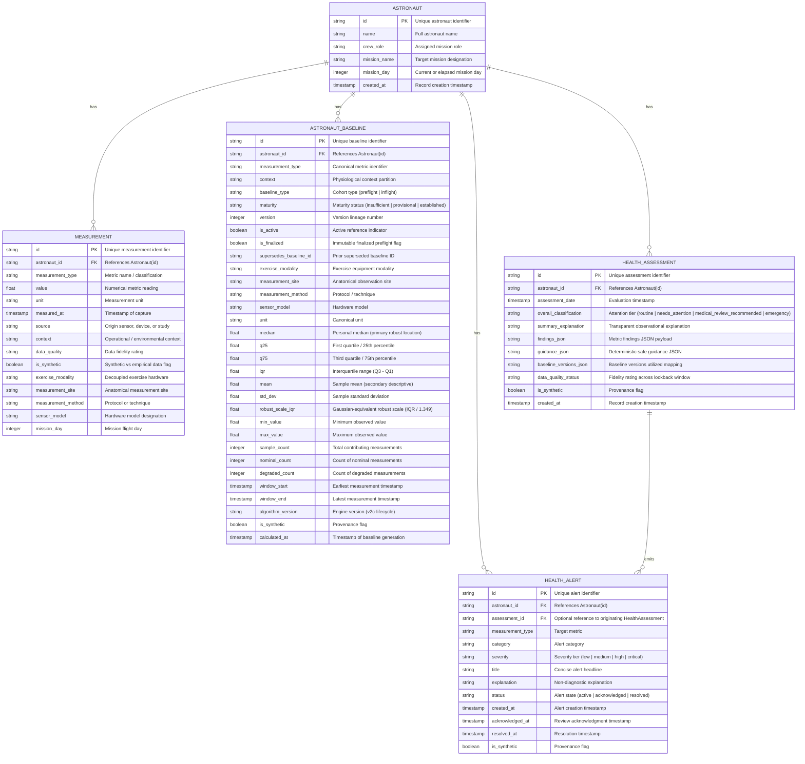

# COSMOLOOKUP Database Schema Specification

> **Status:** Agreed & Authoritative  
> **Database Engine:** SQLite 3 (Development) / PostgreSQL (Production Compatible)  
> **ORM Target:** SQLAlchemy 2.0 / SQLModel  
> **Date:** 2026-11-14  

---

## 1. Entity-Relationship Overview

COSMOLOOKUP organizes telemetry and derived reference baselines around individual astronauts participating in space missions. Each astronaut serves as a root entity to which zero or more time-series physiological, environmental, and operational measurements, as well as calculated personal baseline reference envelopes, are linked.



---

## 2. Entity Definitions

### 2.1. `Astronaut`

Represents an individual crew member participating in a spaceflight mission.

| Column | Data Type | Nullable | Default | Constraints & Description |
|---|---|---|---|---|
| `id` | `VARCHAR(64)` | No | — | **Primary Key**. Unique identifier (e.g., `"astro-001"`). |
| `name` | `VARCHAR(255)` | No | — | Full name of the astronaut. |
| `crew_role` | `VARCHAR(128)` | No | — | Mission role (e.g., `"Commander"`, `"Flight Engineer"`, `"Medical Officer"`). |
| `mission_name` | `VARCHAR(128)` | No | — | Name/code of the mission (e.g., `"Artemis VII"`, `"ISS Expedition 74"`). |
| `mission_day` | `INTEGER` | No | `0` | Elapsed mission flight day (`CHECK (mission_day >= 0)`). |
| `created_at` | `TIMESTAMP WITH TIME ZONE` | No | `CURRENT_TIMESTAMP` | UTC timestamp when this astronaut record was created. |

#### Indices
- `pk_astronaut`: Primary index on `id`.
- `idx_astronaut_mission`: B-tree index on `mission_name` to accelerate mission-level roster lookups.

---

### 2.2. `Measurement`

Represents a discrete physiological vitals sample, environmental reading, or operational telemetry point associated with an astronaut.

| Column | Data Type | Nullable | Default | Constraints & Description |
|---|---|---|---|---|
| `id` | `VARCHAR(64)` | No | — | **Primary Key**. Unique identifier (e.g., `"meas-10045"`). |
| `astronaut_id` | `VARCHAR(64)` | No | — | **Foreign Key** referencing `astronaut(id)` with `ON DELETE CASCADE`. |
| `measurement_type` | `VARCHAR(64)` | No | — | Classification of the metric (e.g., `"heart_rate"`, `"spo2"`, `"core_temperature"`, `"radiation_dose"`). |
| `value` | `DOUBLE PRECISION` / `REAL` | No | — | Numerical measurement value. |
| `unit` | `VARCHAR(32)` | No | — | Standard unit of measure (e.g., `"bpm"`, `"%"`, `"celsius"`, `"mSv"`). |
| `measured_at` | `TIMESTAMP WITH TIME ZONE` | No | — | Exact UTC timestamp when the measurement was taken. |
| `source` | `VARCHAR(128)` | No | — | Originating sensor, hardware subsystem, or analog study (e.g., `"BioHarness v3"`). |
| `context` | `VARCHAR(255)` | Yes | `NULL` | Operational context during acquisition (e.g., `"resting_cabin"`, `"sleep_cycle"`). |
| `data_quality` | `VARCHAR(32)` | No | `'nominal'` | Quality indicator (`CHECK (data_quality IN ('nominal', 'degraded', 'noisy', 'interpolated', 'calibrating'))`). |
| `is_synthetic` | `BOOLEAN` | No | `TRUE` | Explicit flag: `TRUE` for algorithmic/model-generated data, `FALSE` for empirical clinical data. |
| `exercise_modality` | `VARCHAR(64)` | Yes | `NULL` | Decoupled exercise equipment modality (`ared_resistive`, `cevis_aerobic`, `t2_treadmill`). |
| `measurement_site` | `VARCHAR(64)` | Yes | `NULL` | Anatomical observation site (e.g., `"gastrointestinal_tract"`, `"finger"`). |
| `measurement_method` | `VARCHAR(64)` | Yes | `NULL` | Measurement protocol or technique. |
| `sensor_model` | `VARCHAR(64)` | Yes | `NULL` | Hardware or sensor model designation. |
| `mission_day` | `INTEGER` | Yes | `NULL` | Mission elapsed day during observation. |

#### Foreign Key Constraints
- `fk_measurement_astronaut`: `FOREIGN KEY (astronaut_id) REFERENCES astronaut(id) ON DELETE CASCADE ON UPDATE CASCADE`.

#### Indices
- `pk_measurement`: Primary index on `id`.
- `idx_measurement_astronaut`: Index on `astronaut_id` for relational lookups.
- `idx_measurement_timeline`: Composite index on `(astronaut_id, measurement_type, measured_at DESC)` to optimize time-series queries.

---

### 2.3. `AstronautBaseline`

Represents a calculated personal physiological baseline envelope for an individual astronaut under comparable contextual partitions.

| Column | Data Type | Nullable | Default | Constraints & Description |
|---|---|---|---|---|
| `id` | `VARCHAR(64)` | No | — | **Primary Key**. Unique baseline identifier (e.g. `"base-7f3b8901"`). |
| `astronaut_id` | `VARCHAR(64)` | No | — | **Foreign Key** referencing `astronaut(id)` with `ON DELETE CASCADE`. |
| `measurement_type` | `VARCHAR(64)` | No | — | Canonical metric identifier (e.g. `"heart_rate"`, `"spo2"`, `"body_temperature"`). |
| `context` | `VARCHAR(64)` | No | `'resting_cabin'` | Baseline-eligible context partition (`CHECK (context IN ('resting_cabin', 'sleep_cycle', 'exercise_active', 'exercise_recovery'))`). |
| `exercise_modality` | `VARCHAR(64)` | Yes | `NULL` | Equipment modality for exercise baselines. |
| `measurement_site` | `VARCHAR(64)` | Yes | `NULL` | Specific anatomical observation site. |
| `measurement_method` | `VARCHAR(64)` | Yes | `NULL` | Specific measurement protocol. |
| `sensor_model` | `VARCHAR(64)` | Yes | `NULL` | Hardware model designation. |
| `unit` | `VARCHAR(32)` | No | — | Standard canonical unit. |
| `median` | `REAL` | No | — | Personal median (primary non-parametric location estimator). |
| `q25` | `REAL` | No | — | First quartile (25th percentile). |
| `q75` | `REAL` | No | — | Third quartile (75th percentile). |
| `iqr` | `REAL` | No | — | Interquartile range ($Q_3 - Q_1$, primary non-parametric scale estimator). |
| `baseline_type` | `VARCHAR(32)` | No | `'inflight'` | Cohort classification (`'preflight'` or `'inflight'`). |
| `maturity` | `VARCHAR(32)` | No | `'insufficient'` | Maturity status (`'insufficient'`, `'provisional'`, `'established'`). |
| `version` | `INTEGER` | No | `1` | Sequential version lineage number. |
| `is_active` | `BOOLEAN` | No | `TRUE` | Whether this record is the active baseline reference. |
| `is_finalized` | `BOOLEAN` | No | `FALSE` | Whether this preflight baseline is locked and immutable. |
| `supersedes_baseline_id` | `VARCHAR(64)` | Yes | `NULL` | Prior baseline identifier superseded by this version. |
| `maturity_evaluated_at` | `TIMESTAMP WITH TIME ZONE` | Yes | `NULL` | Timestamp of last maturity assessment. |
| `maturity_criteria_snapshot` | `TEXT` | Yes | `NULL` | JSON snapshot of sample count and days evaluated. |
| `mean` | `REAL` | No | — | Sample mean (secondary descriptive statistic). |
| `std_dev` | `REAL` | No | — | Sample standard deviation (secondary descriptive statistic). |
| `robust_scale_iqr` | `REAL` | No | — | Gaussian-equivalent robust scale estimate ($\text{IQR} / 1.349$). |
| `min_value` | `REAL` | No | — | Minimum observed value in baseline cohort. |
| `max_value` | `REAL` | No | — | Maximum observed value in baseline cohort. |
| `sample_count` | `INTEGER` | No | — | Number of valid contributing measurements (`CHECK (sample_count >= 0)`). |
| `nominal_count` | `INTEGER` | No | `0` | Count of nominal-quality measurements evaluated. |
| `degraded_count` | `INTEGER` | No | `0` | Count of non-nominal (degraded/noisy) measurements evaluated. |
| `window_start` | `TIMESTAMP WITH TIME ZONE` | Yes | `NULL` | Earliest measurement timestamp in cohort. |
| `window_end` | `TIMESTAMP WITH TIME ZONE` | Yes | `NULL` | Latest measurement timestamp in cohort. |
| `algorithm_version` | `VARCHAR(32)` | No | `'v2c-lifecycle'` | Baseline calculation algorithm identifier. |
| `is_synthetic` | `BOOLEAN` | No | `TRUE` | Synthetic provenance indicator. |
| `calculated_at` | `TIMESTAMP WITH TIME ZONE` | No | `CURRENT_TIMESTAMP` | UTC timestamp of baseline calculation. |

#### Indices
- `pk_astronaut_baseline`: Primary index on `id`.
- `idx_baseline_astronaut`: Index on `astronaut_id`.
- `idx_baseline_lookup`: Composite index on `(astronaut_id, measurement_type, context)`.
- `idx_baseline_active`: Composite index on `(astronaut_id, baseline_type, measurement_type, is_active)`.

---

### 2.4. `HealthAssessment`

Stores multi-metric diagnostic support evaluations synthesizing intra-individual trends, active baseline references, and deterministic decision rules.

| Column | Data Type | Nullable | Default | Constraints & Description |
|---|---|---|---|---|
| `id` | `VARCHAR(64)` | No | — | **Primary Key**. Unique assessment identifier (e.g., `"asm-81f72a"`). |
| `astronaut_id` | `VARCHAR(64)` | No | — | **Foreign Key** referencing `astronaut(id)`. |
| `assessment_date` | `TIMESTAMP WITH TIME ZONE` | No | `CURRENT_TIMESTAMP` | Timestamp of assessment generation. |
| `overall_classification` | `VARCHAR(32)` | No | — | Attention classification tier (`'routine'`, `'needs_attention'`, `'medical_review_recommended'`, `'emergency'`). |
| `summary_explanation` | `TEXT` | No | — | Structured, natural-language explanation of findings. |
| `findings_json` | `TEXT` | No | `'[]'` | JSON payload of per-metric findings. |
| `guidance_json` | `TEXT` | No | `'[]'` | JSON payload of deterministic non-diagnostic guidance items. |
| `baseline_versions_json` | `TEXT` | No | `'{}'` | JSON mapping of metric types to baseline versions used. |
| `data_quality_status` | `VARCHAR(32)` | No | `'nominal'` | Overall quality across lookback window. |
| `is_synthetic` | `BOOLEAN` | No | `TRUE` | Provenance flag. |
| `created_at` | `TIMESTAMP WITH TIME ZONE` | No | `CURRENT_TIMESTAMP` | UTC record creation timestamp. |

#### Indices
- `pk_health_assessment`: Primary index on `id`.
- `idx_assessment_astronaut`: Index on `astronaut_id`.
- `idx_assessment_timeline`: Composite index on `(astronaut_id, assessment_date DESC)`.

---

### 2.5. `HealthAlert`

Represents operational health alerts requiring operator review or medical officer action.

| Column | Data Type | Nullable | Default | Constraints & Description |
|---|---|---|---|---|
| `id` | `VARCHAR(64)` | No | — | **Primary Key**. Unique alert identifier (e.g., `"alt-b901fc"`). |
| `astronaut_id` | `VARCHAR(64)` | No | — | **Foreign Key** referencing `astronaut(id)`. |
| `assessment_id` | `VARCHAR(64)` | Yes | `NULL` | Optional **Foreign Key** referencing originating `health_assessment(id)`. |
| `measurement_type` | `VARCHAR(64)` | No | — | Metric classification related to alert. |
| `category` | `VARCHAR(64)` | No | — | Alert category (`'physiological_shift'`, `'data_staleness'`, etc.). |
| `severity` | `VARCHAR(32)` | No | `'medium'` | Severity tier (`'low'`, `'medium'`, `'high'`, `'critical'`). |
| `title` | `VARCHAR(255)` | No | — | Concise headline summary. |
| `explanation` | `TEXT` | No | — | Transparent non-diagnostic explanation. |
| `status` | `VARCHAR(32)` | No | `'active'` | Alert state (`'active'`, `'acknowledged'`, `'resolved'`). |
| `created_at` | `TIMESTAMP WITH TIME ZONE` | No | `CURRENT_TIMESTAMP` | UTC creation timestamp. |
| `acknowledged_at` | `TIMESTAMP WITH TIME ZONE` | Yes | `NULL` | Timestamp when operator acknowledged alert. |
| `resolved_at` | `TIMESTAMP WITH TIME ZONE` | Yes | `NULL` | Timestamp when alert was marked resolved. |
| `is_synthetic` | `BOOLEAN` | No | `TRUE` | Provenance flag. |

#### Indices
- `pk_health_alert`: Primary index on `id`.
- `idx_alert_astronaut`: Index on `astronaut_id`.
- `idx_alert_status`: Composite index on `(astronaut_id, status)`.

---

## 3. SQL DDL Specification (Reference Implementation)

```sql
-- Table: astronaut
CREATE TABLE astronaut (
    id VARCHAR(64) PRIMARY KEY,
    name VARCHAR(255) NOT NULL,
    crew_role VARCHAR(128) NOT NULL,
    mission_name VARCHAR(128) NOT NULL,
    mission_day INTEGER NOT NULL DEFAULT 0 CHECK (mission_day >= 0),
    created_at TIMESTAMP WITH TIME ZONE NOT NULL DEFAULT CURRENT_TIMESTAMP
);

CREATE INDEX idx_astronaut_mission ON astronaut(mission_name);

-- Table: measurement
CREATE TABLE measurement (
    id VARCHAR(64) PRIMARY KEY,
    astronaut_id VARCHAR(64) NOT NULL,
    measurement_type VARCHAR(64) NOT NULL,
    value REAL NOT NULL,
    unit VARCHAR(32) NOT NULL,
    measured_at TIMESTAMP WITH TIME ZONE NOT NULL,
    source VARCHAR(128) NOT NULL,
    context VARCHAR(255),
    data_quality VARCHAR(32) NOT NULL DEFAULT 'nominal',
    is_synthetic BOOLEAN NOT NULL DEFAULT 1,
    exercise_modality VARCHAR(64),
    measurement_site VARCHAR(64),
    measurement_method VARCHAR(64),
    sensor_model VARCHAR(64),
    mission_day INTEGER,
    CONSTRAINT fk_measurement_astronaut FOREIGN KEY (astronaut_id)
        REFERENCES astronaut(id) ON DELETE CASCADE ON UPDATE CASCADE,
    CONSTRAINT chk_data_quality CHECK (data_quality IN ('nominal', 'degraded', 'noisy', 'interpolated', 'calibrating'))
);

CREATE INDEX idx_measurement_astronaut ON measurement(astronaut_id);
CREATE INDEX idx_measurement_timeline ON measurement(astronaut_id, measurement_type, measured_at DESC);

-- Table: astronaut_baseline
CREATE TABLE astronaut_baseline (
    id VARCHAR(64) PRIMARY KEY,
    astronaut_id VARCHAR(64) NOT NULL,
    measurement_type VARCHAR(64) NOT NULL,
    context VARCHAR(64) NOT NULL DEFAULT 'resting_cabin',
    baseline_type VARCHAR(32) NOT NULL DEFAULT 'inflight',
    maturity VARCHAR(32) NOT NULL DEFAULT 'insufficient',
    version INTEGER NOT NULL DEFAULT 1,
    is_active BOOLEAN NOT NULL DEFAULT 1,
    is_finalized BOOLEAN NOT NULL DEFAULT 0,
    supersedes_baseline_id VARCHAR(64),
    maturity_evaluated_at TIMESTAMP WITH TIME ZONE,
    maturity_criteria_snapshot TEXT,
    exercise_modality VARCHAR(64),
    measurement_site VARCHAR(64),
    measurement_method VARCHAR(64),
    sensor_model VARCHAR(64),
    unit VARCHAR(32) NOT NULL,
    median REAL NOT NULL,
    q25 REAL NOT NULL,
    q75 REAL NOT NULL,
    iqr REAL NOT NULL,
    mean REAL NOT NULL,
    std_dev REAL NOT NULL,
    robust_scale_iqr REAL NOT NULL,
    min_value REAL NOT NULL,
    max_value REAL NOT NULL,
    sample_count INTEGER NOT NULL CHECK (sample_count >= 0),
    nominal_count INTEGER NOT NULL DEFAULT 0,
    degraded_count INTEGER NOT NULL DEFAULT 0,
    window_start TIMESTAMP WITH TIME ZONE,
    window_end TIMESTAMP WITH TIME ZONE,
    algorithm_version VARCHAR(32) NOT NULL DEFAULT 'v2c-lifecycle',
    is_synthetic BOOLEAN NOT NULL DEFAULT 1,
    calculated_at TIMESTAMP WITH TIME ZONE NOT NULL DEFAULT CURRENT_TIMESTAMP,
    CONSTRAINT fk_baseline_astronaut FOREIGN KEY (astronaut_id)
        REFERENCES astronaut(id) ON DELETE CASCADE ON UPDATE CASCADE,
    CONSTRAINT chk_baseline_context CHECK (context IN ('resting_cabin', 'sleep_cycle', 'exercise_active', 'exercise_recovery')),
    CONSTRAINT chk_baseline_type CHECK (baseline_type IN ('preflight', 'inflight')),
    CONSTRAINT chk_baseline_maturity CHECK (maturity IN ('insufficient', 'provisional', 'established'))
);

CREATE INDEX idx_baseline_astronaut ON astronaut_baseline(astronaut_id);
CREATE INDEX idx_baseline_lookup ON astronaut_baseline(astronaut_id, measurement_type, context);
CREATE INDEX idx_baseline_active ON astronaut_baseline(astronaut_id, baseline_type, measurement_type, is_active);

-- Table: health_assessment
CREATE TABLE health_assessment (
    id VARCHAR(64) PRIMARY KEY,
    astronaut_id VARCHAR(64) NOT NULL,
    assessment_date TIMESTAMP WITH TIME ZONE NOT NULL DEFAULT CURRENT_TIMESTAMP,
    overall_classification VARCHAR(32) NOT NULL,
    summary_explanation TEXT NOT NULL,
    findings_json TEXT NOT NULL DEFAULT '[]',
    guidance_json TEXT NOT NULL DEFAULT '[]',
    baseline_versions_json TEXT NOT NULL DEFAULT '{}',
    data_quality_status VARCHAR(32) NOT NULL DEFAULT 'nominal',
    is_synthetic BOOLEAN NOT NULL DEFAULT 1,
    created_at TIMESTAMP WITH TIME ZONE NOT NULL DEFAULT CURRENT_TIMESTAMP,
    CONSTRAINT fk_assessment_astronaut FOREIGN KEY (astronaut_id)
        REFERENCES astronaut(id) ON DELETE CASCADE ON UPDATE CASCADE,
    CONSTRAINT chk_assessment_classification CHECK (overall_classification IN ('routine', 'needs_attention', 'medical_review_recommended', 'emergency'))
);

CREATE INDEX idx_assessment_astronaut ON health_assessment(astronaut_id);
CREATE INDEX idx_assessment_timeline ON health_assessment(astronaut_id, assessment_date DESC);

-- Table: health_alert
CREATE TABLE health_alert (
    id VARCHAR(64) PRIMARY KEY,
    astronaut_id VARCHAR(64) NOT NULL,
    assessment_id VARCHAR(64),
    measurement_type VARCHAR(64) NOT NULL,
    category VARCHAR(64) NOT NULL,
    severity VARCHAR(32) NOT NULL DEFAULT 'medium',
    title VARCHAR(255) NOT NULL,
    explanation TEXT NOT NULL,
    status VARCHAR(32) NOT NULL DEFAULT 'active',
    created_at TIMESTAMP WITH TIME ZONE NOT NULL DEFAULT CURRENT_TIMESTAMP,
    acknowledged_at TIMESTAMP WITH TIME ZONE,
    resolved_at TIMESTAMP WITH TIME ZONE,
    is_synthetic BOOLEAN NOT NULL DEFAULT 1,
    CONSTRAINT fk_alert_astronaut FOREIGN KEY (astronaut_id)
        REFERENCES astronaut(id) ON DELETE CASCADE ON UPDATE CASCADE,
    CONSTRAINT fk_alert_assessment FOREIGN KEY (assessment_id)
        REFERENCES health_assessment(id) ON DELETE SET NULL,
    CONSTRAINT chk_alert_severity CHECK (severity IN ('low', 'medium', 'high', 'critical')),
    CONSTRAINT chk_alert_status CHECK (status IN ('active', 'acknowledged', 'resolved'))
);

CREATE INDEX idx_alert_astronaut ON health_alert(astronaut_id);
CREATE INDEX idx_alert_status ON health_alert(astronaut_id, status);
```
```
