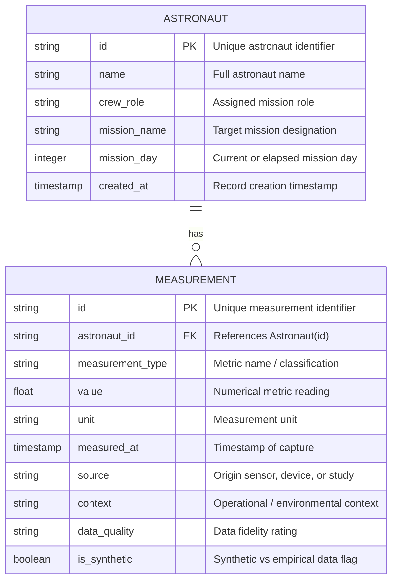

# COSMOLOOKUP Database Schema Specification

> **Status:** Agreed & Authoritative  
> **Database Engine:** SQLite 3 (Development) / PostgreSQL (Production Compatible)  
> **ORM Target:** SQLAlchemy 2.0 / SQLModel  
> **Date:** 2026-11-14  

---

## 1. Entity-Relationship Overview

COSMOLOOKUP organizes telemetry around individual astronauts participating in space missions. Each astronaut serves as a root entity to which zero or more time-series physiological, environmental, and operational measurements are linked.



---

## 2. Entity Definitions

### 2.1. `Astronaut`

Represents an individual crew member participating in a spaceflight mission.

| Column | Data Type | Nullable | Default | Constraints & Description |
|---|---|---|---|---|
| `id` | `VARCHAR(64)` | No | — | **Primary Key**. Unique identifier (e.g., `"astro-001"`). |
| `name` | `VARCHAR(255)` | No | — | Full name of the astronaut. |
| `crew_role` | `VARCHAR(128)` | No | — | Mission role (e.g., `"Commander"`, `"Flight Engineer"`, `"Medical Officer"`). |
| `mission_name` | `VARCHAR(128)` | No | — | Name/code of the mission (e.g., `"Artemis VII"`, `"ISS Expedition 74"`). |
| `mission_day` | `INTEGER` | No | `0` | Elapsed mission flight day (`CHECK (mission_day >= 0)`). |
| `created_at` | `TIMESTAMP WITH TIME ZONE` | No | `CURRENT_TIMESTAMP` | UTC timestamp when this astronaut record was created. |

#### Indices
- `pk_astronaut`: Primary index on `id`.
- `idx_astronaut_mission`: B-tree index on `mission_name` to accelerate mission-level roster lookups.

---

### 2.2. `Measurement`

Represents a discrete physiological vitals sample, environmental reading, or operational telemetry point associated with an astronaut.

| Column | Data Type | Nullable | Default | Constraints & Description |
|---|---|---|---|---|
| `id` | `VARCHAR(64)` | No | — | **Primary Key**. Unique identifier (e.g., `"meas-10045"`). |
| `astronaut_id` | `VARCHAR(64)` | No | — | **Foreign Key** referencing `astronaut(id)` with `ON DELETE CASCADE`. |
| `measurement_type` | `VARCHAR(64)` | No | — | Classification of the metric (e.g., `"heart_rate"`, `"blood_oxygen"`, `"core_temperature"`, `"radiation_dose"`). |
| `value` | `DOUBLE PRECISION` / `REAL` | No | — | Numerical measurement value. |
| `unit` | `VARCHAR(32)` | No | — | Standard unit of measure (e.g., `"bpm"`, `"%"`, `"celsius"`, `"mSv"`). |
| `measured_at` | `TIMESTAMP WITH TIME ZONE` | No | — | Exact UTC timestamp when the measurement was taken. |
| `source` | `VARCHAR(128)` | No | — | Originating sensor, hardware subsystem, or analog study (e.g., `"BioHarness v3"`, `"LSDA Study #442"`). |
| `context` | `VARCHAR(255)` | Yes | `NULL` | Operational context during acquisition (e.g., `"EVA Workday"`, `"Sleep Period"`, `"High Stress Exercise"`). |
| `data_quality` | `VARCHAR(32)` | No | `'nominal'` | Quality indicator (`CHECK (data_quality IN ('nominal', 'degraded', 'noisy', 'interpolated', 'calibrating'))`). |
| `is_synthetic` | `BOOLEAN` | No | `TRUE` | Explicit flag: `TRUE` for algorithmic/model-generated data, `FALSE` for real historical or empirical clinical data. |

#### Foreign Key Constraints
- `fk_measurement_astronaut`: `FOREIGN KEY (astronaut_id) REFERENCES astronaut(id) ON DELETE CASCADE ON UPDATE CASCADE`.

#### Indices
- `pk_measurement`: Primary index on `id`.
- `idx_measurement_astronaut`: Index on `astronaut_id` for relational lookups.
- `idx_measurement_timeline`: Composite index on `(astronaut_id, measurement_type, measured_at DESC)` to optimize high-performance time-series queries and dashboard range plotting.

---

## 3. SQL DDL Specification (Reference Implementation)

```sql
-- Table: astronaut
CREATE TABLE astronaut (
    id VARCHAR(64) PRIMARY KEY,
    name VARCHAR(255) NOT NULL,
    crew_role VARCHAR(128) NOT NULL,
    mission_name VARCHAR(128) NOT NULL,
    mission_day INTEGER NOT NULL DEFAULT 0 CHECK (mission_day >= 0),
    created_at TIMESTAMP WITH TIME ZONE NOT NULL DEFAULT CURRENT_TIMESTAMP
);

CREATE INDEX idx_astronaut_mission ON astronaut(mission_name);

-- Table: measurement
CREATE TABLE measurement (
    id VARCHAR(64) PRIMARY KEY,
    astronaut_id VARCHAR(64) NOT NULL,
    measurement_type VARCHAR(64) NOT NULL,
    value REAL NOT NULL,
    unit VARCHAR(32) NOT NULL,
    measured_at TIMESTAMP WITH TIME ZONE NOT NULL,
    source VARCHAR(128) NOT NULL,
    context VARCHAR(255),
    data_quality VARCHAR(32) NOT NULL DEFAULT 'nominal',
    is_synthetic BOOLEAN NOT NULL DEFAULT 1,
    CONSTRAINT fk_measurement_astronaut FOREIGN KEY (astronaut_id)
        REFERENCES astronaut(id) ON DELETE CASCADE ON UPDATE CASCADE,
    CONSTRAINT chk_data_quality CHECK (data_quality IN ('nominal', 'degraded', 'noisy', 'interpolated', 'calibrating'))
);

CREATE INDEX idx_measurement_astronaut ON measurement(astronaut_id);
CREATE INDEX idx_measurement_timeline ON measurement(astronaut_id, measurement_type, measured_at DESC);
```

---

## 4. Key Architectural Considerations & Constraints

1. **Cascade Deletion:**  
   If an `astronaut` profile is deleted, all historical `measurement` telemetry linked to that astronaut is removed via `ON DELETE CASCADE` to maintain referential integrity without orphan records.

2. **Temporal Consistency:**  
   `measured_at` timestamps must always be stored in ISO 8601 UTC. Display formatting to mission elapsed time (MET) or local mission clock is handled by presentation layers.

3. **Data Provenance (`is_synthetic`):**  
   NASA Space Apps challenges frequently blend actual spaceflight telemetry (from the NASA Open Data Portal / Life Sciences Data Archive) with synthetic physiological models. The boolean flag `is_synthetic` ensures strict scientific integrity by preventing simulated figures from being mistaken for clinical telemetry.

4. **Time-Series Query Efficiency:**  
   The composite index `(astronaut_id, measurement_type, measured_at DESC)` ensures queries filtering by astronaut vitals across a given time window execute in logarithmic time, supporting interactive dashboard chart re-rendering.
