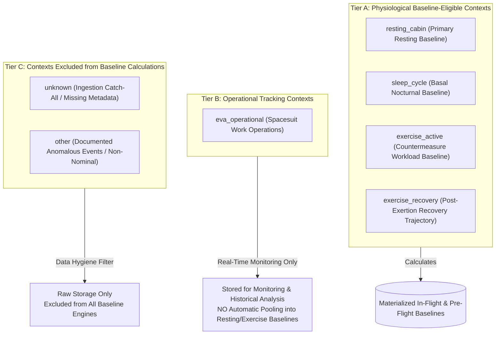
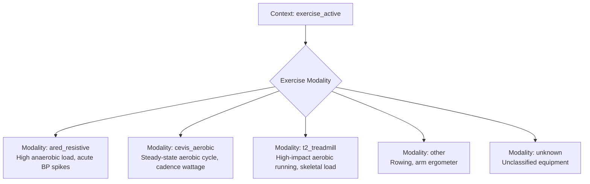
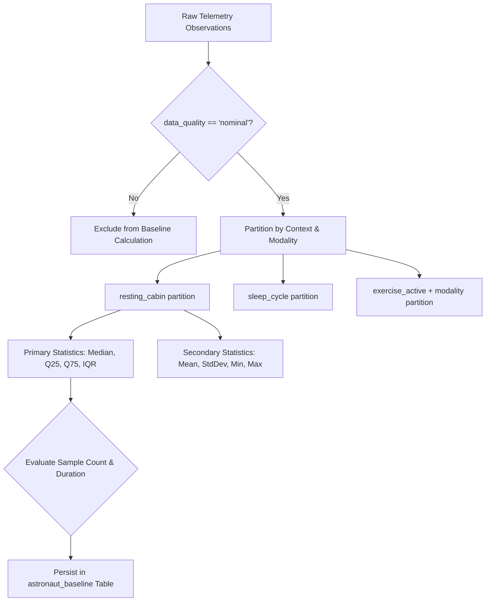
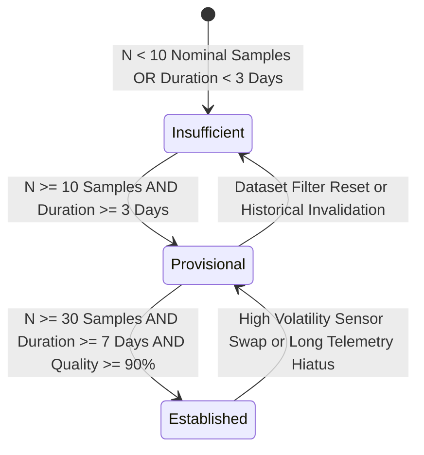
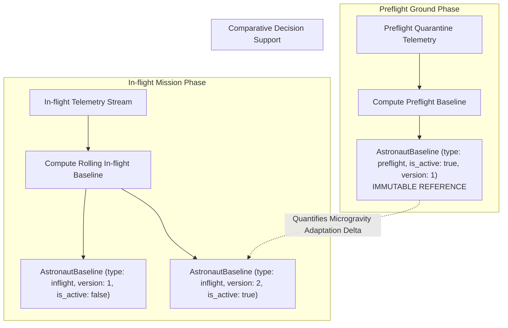
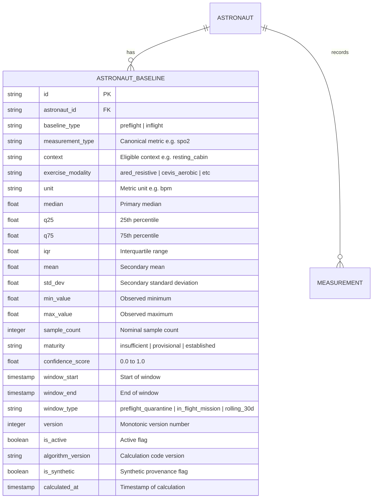
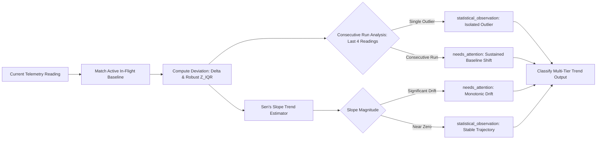
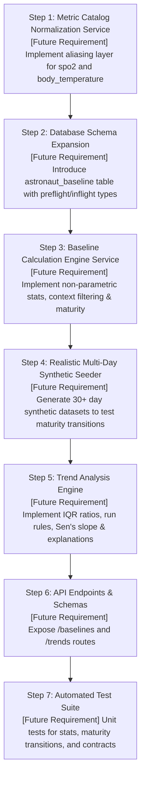

# COSMOLOOKUP — Phase 2 Architecture Specification: Personal Baseline and Trend Analysis

> **Document:** Phase 2 Architecture Specification & Research Alignment (Targeted Final Revision 3)  
> **Status:** Proposal / Finalized for Human Project Lead Review & Approval  
> **Branch:** `feature/backend-api`  
> **Target Audience:** Project Architect, Backend Developers, Frontend Team, Research Specialist (Member 3), NASA Space Apps Evaluators  
> **Author:** Senior Python Backend Developer & System Architect  
> **Date:** 2026-11-14  

---

## Executive Summary

In long-duration spaceflight health monitoring, population-wide terrestrial medical reference intervals (e.g., standard adult resting heart rate 60–100 bpm) are inadequate for deep-space mission operational decision support. Astronauts are highly trained, physiologically unique individuals undergoing significant physiological adaptations to microgravity—including cephalad fluid redistribution, cardiovascular deconditioning, neurovestibular readaptation, and bone/muscle metabolism shifts.

A personalized, context-aware baseline engine that references an astronaut's telemetry against their own historical norms provides a far more sensitive and clinically meaningful reference.

This document presents the **finalized Phase 2 architectural design**, incorporating targeted corrections from project-lead and scientific review:
1. **Catalog & API Identifier Architecture:** Formal four-tier compatibility strategy distinguishing input aliases, internal canonical identifiers, API response identifiers, and historical database values. Enforces `spo2` and `blood_oxygen` alias compatibility while establishing `body_temperature` and `core_temperature` as **strictly distinct, non-aliasing identifiers** with independent baselines.
2. **Context & Baseline Eligibility Taxonomy:** Explicit classification of telemetry contexts into three functional tiers: **Physiological Baseline-Eligible Contexts** (`resting_cabin`, `sleep_cycle`, `exercise_active`, `exercise_recovery`), **Operational Tracking Contexts** (`eva_operational`), and **Contexts Excluded from Baseline Calculations** (`unknown`, `other`). Exercise hardware modalities (`ared_resistive`, `cevis_aerobic`, `t2_treadmill`) remain decoupled.
3. **Dual Baseline Framework:** Total architectural decoupling between immutable **Preflight Reference Baselines** and versioned, evolving **In-flight Baselines**.
4. **Robust Standardized Deviation ($Z_{\text{IQR}}$):** Mathematically rigorous formulation of $Z_{\text{IQR}}$ based on $\text{IQR} / 1.349$ as a **consistent scale estimator under normal-distribution assumptions** with an explicit **25% breakdown point** (contrasted with the median's 50% breakdown point), degenerate baseline ($\text{IQR} \approx 0$) guards, and non-diagnostic constraints.
5. **Multi-Tier Trend Output Classification:** Formal operational distinction between statistical observations, data-quality warnings, operational needs-attention flags, and medical review recommendations.
6. **Testable Frontend Compatibility Protocol:** Replacement of unconditional compatibility assumptions with an explicit suite of five regression and contract tests prior to frontend integration.
7. **Implementation Readiness Checklist:** An operational audit inventory cleanly separating approved decisions from pending research gates.

> [!IMPORTANT]
> **Status of this Document:** This is a design and architectural planning document. It **does not alter existing repository API contracts or database schemas**. All schema, model, and endpoint additions described herein represent proposals for subsequent implementation upon human project lead approval.

---

## Document Governance: Classification of Statements

To prevent architectural ambiguity, every major decision in this document is explicitly labeled under one of four governance tiers:

- **`[ACCEPTED RECOMMENDATION]`**: Decisions reviewed and formally approved by Member 3 (Research Specialist) and the Backend Lead.
- **`[PROPOSED ENGINEERING DECISION]`**: Concrete software designs, schema structures, or algorithms proposed by the Backend Architect pending human review.
- **`[UNRESOLVED RESEARCH QUESTION]`**: Scientific or clinical questions requiring empirical dataset verification or flight surgeon input before finalization.
- **`[FUTURE IMPLEMENTATION REQUIREMENT]`**: Downstream development steps scheduled for Phase 2 execution after design sign-off.

---

## 1. Existing Implementation Review

### 1.1 Source-of-Truth Codebase Inspection

Inspection of the existing [`feature/backend-api`](file:///D:/nasa2026) implementation establishes the following authoritative foundation:

| Component | Repository Path | Current Status & Implementation Details |
|---|---|---|
| **Data Models** | [`backend/app/models/`](file:///D:/nasa2026/backend/app/models) | Clean SQLAlchemy 2.0 declarative models for `Astronaut` and `Measurement`. Primary keys are `String(64)` matching [`docs/architecture/DATABASE_SCHEMA.md`](file:///D:/nasa2026/docs/architecture/DATABASE_SCHEMA.md). `Measurement` includes `astronaut_id` (FK with cascade delete), `measurement_type`, `value`, `unit`, `measured_at`, `source`, `context`, `data_quality`, and `is_synthetic`. |
| **Pydantic Schemas** | [`backend/app/schemas/`](file:///D:/nasa2026/backend/app/schemas) | Typed V2 models (`AstronautResponse`, `MeasurementResponse`, `MeasurementListResponse`). Custom serializers enforce ISO 8601 UTC with `Z` suffix. Error envelopes follow `{ "error": { "code", "message", "details" } }`. |
| **API Endpoints** | [`backend/app/api/v1/endpoints/`](file:///D:/nasa2026/backend/app/api/v1/endpoints) | Three public endpoints: `GET /api/v1/astronauts`, `GET /api/v1/astronauts/{astronaut_id}`, and `GET /api/v1/astronauts/{astronaut_id}/measurements` supporting pagination and filtering (`measurement_type`, `start_time`, `end_time`). |
| **Services** | [`backend/app/services/`](file:///D:/nasa2026/backend/app/services) | Decoupled query functions for astronaut profiles and telemetry retrieval. |
| **Seed Telemetry** | [`backend/app/seed.py`](file:///D:/nasa2026/backend/app/seed.py) | Idempotent seeder providing 25 synthetic measurements for astronaut Alex Morgan (`astro-001`) across 4 intervals in Mission Day 45. |
| **Test Suite** | [`backend/tests/`](file:///D:/nasa2026/backend/tests) | 17 automated Pytest suites running against isolated in-memory SQLite (`sqlite:///:memory:`). |

### 1.2 Key Constraints Established by Phase 1
1. **Database Identifiers `[ACCEPTED RECOMMENDATION]`:** Stored rows in SQLite use `measurement_type` as currently seeded (`spo2`, `body_temperature`, `heart_rate`, etc.).
2. **API Contract Compatibility `[ACCEPTED RECOMMENDATION]`:** [`docs/api/API_CONTRACT.md`](file:///D:/nasa2026/docs/api/API_CONTRACT.md) documents `blood_oxygen` and `core_temperature`. The existing frontend expects contract-compliant payloads. No backend change may silently break these expectations.
3. **Persisted Baseline Summaries `[PROPOSED ENGINEERING DECISION]`:** Calculating statistical percentiles dynamically across large time-series telemetry sets during API requests introduces unacceptable latency. Persisted baseline summaries avoid recalculation on every request without asserting unrealistic constant-time guarantees.

---

## 2. Scientific Review Decisions (Member 3 Alignment)

The scientific review provided by Member 3 established the following binding principles:

| Domain | Scientific Review Directive | Architectural Impact |
|---|---|---|
| **Measurement Identifiers** | Adopt `spo2` as canonical with `blood_oxygen` as backward-compatible alias. Adopt `body_temperature` as generic canonical identifier. Treat `core_temperature` as a distinct identifier. **Do NOT alias body and core temperature.** | Normalization layer in backend services for SpO2; strict separation and independent baselines for temperature types. |
| **Context Taxonomy** | Classify contexts into 3 eligibility tiers: Baseline-Eligible (`resting_cabin`, `sleep_cycle`, `exercise_active`, `exercise_recovery`), Operational Tracking (`eva_operational`), and Ingestion Excluded (`unknown`, `other`). Preserve original raw source context. | Two-tier context handling: clean baseline cohorts + operational tracking + raw telemetry provenance. |
| **EVA Context Nuance** | Treat EVA (`eva_operational`) as an operational work context, not automatically as a uniform physiological state. EVA vitals must NOT be pooled into resting or exercise baselines. | Precludes combining EVA data into general baselines. Requires independent justification for any future EVA baseline. |
| **Exercise Modality** | Decouple broad `exercise_active` context from specific exercise hardware modalities (`ared_resistive`, `cevis_aerobic`, `t2_treadmill`, `other`, `unknown`). | Two-level classification: context category + modality sub-attribute. |
| **Dual Baseline Framework** | Establish separate **Preflight** and **In-flight** baselines. Never merge preflight and in-flight measurements into a single baseline. | Distinct baseline records with explicit `baseline_type` attributes. |
| **Circadian Timing** | Preserve timestamps and relative sleep/wake timing. Recommend comparing readings from similar time-of-day when data permits, but do NOT make diurnal coverage mandatory for baseline maturity. | Maturity evaluation remains sample- and duration-based; time-of-day matching is an optional trend filter. |
| **Synthetic Telemetry Boundaries** | Acknowledge that 25 seed measurements are demonstration records only. Never claim synthetic data represents actual spaceflight telemetry. | Explicit provenance tracking and simulation disclaimer banners. |

---

## 3. Measurement Catalog and API Identifier Compatibility

### 3.1 Four-Tier Identifier Compatibility Architecture `[PROPOSED ENGINEERING DECISION]`

A common point of failure in evolving telemetry systems is conflating internal code naming with external wire protocols. To ensure seamless backward compatibility while maintaining scientific rigor, the platform explicitly separates four identifier tiers:

```mermaid
flowchart LR
    subgraph Tier1 ["Tier 1: Accepted Input Aliases"]
        In1["blood_oxygen"]
        In2["spo2"]
        In3["body_temperature"]
        In4["core_temperature"]
    end

    subgraph Tier2 ["Tier 2: Internal Canonical Identifiers"]
        CanonSpO2["spo2 (Canonical)"]
        CanonBodyTemp["body_temperature (Canonical)"]
        CanonCoreTemp["core_temperature (Distinct)"]
    end

    subgraph Tier3 ["Tier 3: Historical Database Identifiers"]
        DBRows[("Stored rows in measurement table<br>Retains 'spo2', 'blood_oxygen',<br>'body_temperature', 'core_temperature'")]
    end

    subgraph Tier4 ["Tier 4: API Response Identifiers"]
        Out1["GET /measurements returns stored row type"]
        Out2["GET /baselines returns canonical metric type"]
    end

    In1 -->|Service Normalization| CanonSpO2
    In2 -->|Direct Match| CanonSpO2
    In3 -->|Direct Match: Independent Path| CanonBodyTemp
    In4 -->|Direct Match: Independent Path| CanonCoreTemp

    CanonSpO2 -->|SQL IN ('spo2', 'blood_oxygen')| DBRows
    CanonBodyTemp -->|SQL WHERE type = 'body_temperature'| DBRows
    CanonCoreTemp -->|SQL WHERE type = 'core_temperature'| DBRows

    DBRows --> Out1
    CanonSpO2 --> Out2
    CanonBodyTemp --> Out2
    CanonCoreTemp --> Out2
```

1. **Tier 1: Accepted Input Aliases (Client Requests):**
   - **SpO2 Compatibility:** The query parameter `?measurement_type=` accepts both `spo2` and `blood_oxygen`. The backend normalization layer resolves both to the canonical `spo2` concept.
   - **Temperature Separation:** The query parameter `?measurement_type=` accepts `body_temperature` and `core_temperature` as **strictly distinct, independent queries**. There is **no automatic aliasing or cross-mapping** between body temperature and core temperature.
2. **Tier 2: Internal Canonical Identifiers (Backend Services & Calculations):**
   - Backend domain logic, baseline engines, and statistical processors exclusively operate on canonical names:
     - `spo2` (with alias resolution from `blood_oxygen`)
     - `body_temperature` (generic canonical body temperature)
     - `core_temperature` (distinct identifier for confirmed deep visceral telemetry)
     - `heart_rate`, `respiratory_rate`, `blood_pressure_systolic`, `blood_pressure_diastolic`, `sleep_duration`, `radiation_dose`
3. **Tier 3: Historical Database Identifiers (Data at Rest):**
   - Existing records in the `measurement` table are **never silently rewritten or mutated**. If a historical record has `measurement_type = 'blood_oxygen'`, it remains intact to protect cryptographic and scientific audit trails.
   - The SpO2 query service uses SQL expansion: `WHERE measurement_type IN ('spo2', 'blood_oxygen')`.
   - The temperature query service queries the exact requested identifier without cross-table bleeding.
4. **Tier 4: API Response Identifiers (Client Payloads):**
   - **Existing Endpoints:** `GET /api/v1/astronauts/{id}/measurements` continues serializing the exact `measurement_type` stored on the row, preserving current client expectations.
   - **New Phase 2 Endpoints:** New endpoints (`/baselines`, `/trends`) return the canonical identifier as primary, alongside an `aliases` array in metadata for transparent discovery.
   - **Contract Governance:** A formal revision of [`docs/api/API_CONTRACT.md`](file:///D:/nasa2026/docs/api/API_CONTRACT.md) will be submitted for project approval before any response identifier change is introduced.

### 3.2 Canonical Measurement Registry `[ACCEPTED RECOMMENDATION]`

| Canonical Identifier | Permitted Input Aliases | Standard Unit | Valid Range (Sanity Check) | Primary Hardware Source Examples | Scientific Definition & Baseline Rule |
|---|---|---|---|---|---|
| `heart_rate` | `hr` | `bpm` | $30.0 - 220.0$ | BioHarness chest band, 3-lead ECG | Ventricular contractions per minute. |
| `spo2` | `blood_oxygen` | `%` | $70.0 - 100.0$ | Optical finger/wrist pulse oximeter | Peripheral capillary oxygen saturation via spectrophotometry. Compatible alias with `blood_oxygen`. |
| `body_temperature` | — | `celsius` | $34.0 - 42.0$ | Infrared skin probe, wearable sensor band | Generic canonical body/skin temperature. **Must NOT share baselines with core_temperature.** |
| `core_temperature` | — | `celsius` | $35.0 - 42.0$ | Ingestible telemetric core pill (LSDA) | Deep visceral internal temperature. **Distinct metric; requires confirmed core sensor metadata.** |
| `blood_pressure_systolic` | `bp_systolic` | `mmHg` | $70.0 - 220.0$ | Ambulatory arterial cuff | Peak arterial pressure during ventricular systole. |
| `blood_pressure_diastolic` | `bp_diastolic` | `mmHg` | $40.0 - 130.0$ | Ambulatory arterial cuff | Minimum arterial pressure during ventricular diastole. |
| `respiratory_rate` | `rr` | `breaths/min` | $4.0 - 45.0$ | Inductive plethysmography band | Breaths / ventilatory cycles completed per minute. |
| `sleep_duration` | — | `hours` | $0.0 - 16.0$ | Actigraphy sleep-staging monitor | Cumulative consolidated sleep period. |
| `radiation_dose` | — | `mSv` | $0.0 - 500.0$ | Crew Active Personal Dosimeter | Ionizing radiation equivalent dose. |

### 3.3 Body Temperature vs. Core Temperature Strict Independence `[ACCEPTED RECOMMENDATION]`

In spaceflight physiology, microgravity diminishes bodily convective heat loss due to the absence of natural buoyancy-driven air circulation. This frequently elevates internal core temperature by $0.5 - 1.0^\circ\text{C}$ ("spaceflight-associated core hyperthermia") while skin temperature fluctuates heavily with cabin airflow, clothing, and evaporative cooling.

1. **No Automatic Aliasing:** `body_temperature` and `core_temperature` are strictly distinct measurement identifiers. Querying one must **never** return or alias the other.
2. **Independent Baselines and Trends:** These two metrics **must not automatically share baselines or trend calculations**. An astronaut will possess an independent baseline for `body_temperature` (skin/wearable) and a separate baseline for `core_temperature` (ingestible capsule).
3. **Metadata Preservation:** Sensor site (e.g., axillary, forehead skin, tympanic, gastrointestinal tract), measurement method, and device model must be preserved in the `source` and `context` attributes whenever available.
4. **Conditional Ingestion:** Telemetry is classified as `body_temperature` by default. The identifier `core_temperature` is assigned **only when sensor metadata explicitly confirms an ingestible core pill or approved deep thermal probe**.

### 3.4 Mean Arterial Pressure (MAP) Formulation `[FUTURE IMPLEMENTATION REQUIREMENT]`

Mean Arterial Pressure (MAP) is documented as a possible future derived cardiovascular metric:

$$\text{MAP} \approx \frac{\text{SBP} + 2 \times \text{DBP}}{3} = \text{DBP} + \frac{1}{3}(\text{SBP} - \text{DBP})$$

- **Calculated Metric:** MAP is a derived mathematical approximation, not a direct sensor reading.
- **Data Preservation:** Original systolic (`blood_pressure_systolic`) and diastolic (`blood_pressure_diastolic`) measurements must always remain available and immutable.
- **Scope Restriction:** MAP calculation is excluded from initial Phase 2 execution and marked as a candidate for future analytics extensions. No clinical alerts or medical thresholds are attached to MAP values.

### 3.5 Testable Frontend and API Compatibility Verification Protocol `[PROPOSED ENGINEERING DECISION]`

Rather than making unconditional claims of frontend compatibility, the platform establishes an explicit, testable verification protocol prior to frontend integration:

| Test Suite / Protocol Gate | Verification Objective | Automated Test Implementation Method |
|---|---|---|
| **1. Existing Endpoint Preservation** | Verify `GET /api/v1/astronauts/{id}/measurements` payload structure remains identical to Phase 1. | Assert top-level keys (`astronaut_id`, `data`, `total`, `limit`, `offset`) and record field presence matching Phase 1 test suite. |
| **2. Frontend Filter Stability** | Verify existing query parameters (`limit`, `offset`, `start_time`, `end_time`, `measurement_type`) behave identically. | Execute parameterized Pytest queries replicating existing React dashboard fetch hooks. |
| **3. SpO2 Alias Normalization** | Verify `?measurement_type=blood_oxygen` returns expected records without breaking clients expecting `blood_oxygen`. | Assert that query for `blood_oxygen` returns records containing historical `blood_oxygen` or `spo2` with HTTP 200. |
| **4. Temperature Distinction Check** | Verify `body_temperature` queries do not return `core_temperature` rows, and vice versa. | Assert zero cross-contamination when querying both endpoints against mixed seed data. |
| **5. New Contract Validation** | Verify new `/baselines` and `/trends` endpoints strictly adhere to Pydantic V2 schema definitions. | Validate response models using strict Pydantic JSON schema assertions before frontend wiring. |

---

## 4. Context and Exercise Modality Taxonomy

### 4.1 Evaluation & Three-Tier Context Baseline Eligibility Taxonomy `[ACCEPTED RECOMMENDATION]`

To resolve ambiguity between operational mission activities and physiological baseline formation, the software classifies all context categories into three functional eligibility tiers:



| Category Key | Eligibility Tier | Operational Definition | Baseline Behavior & Inclusion Rules |
|---|---|---|---|
| **`resting_cabin`** | **Physiological Baseline-Eligible** | Astronaut awake, seated or performing light non-strenuous tasks inside the habitat. | **Primary Resting Baseline.** Forms the reference for nominal daytime non-exertional physiology. |
| **`sleep_cycle`** | **Physiological Baseline-Eligible** | In crew quarters during scheduled circadian sleep window. | **Basal Nocturnal Baseline.** Forms the reference for minimum resting vitals and sleep recovery. |
| **`exercise_active`** | **Physiological Baseline-Eligible** | Performing scheduled physical countermeasures (ARED, CEVIS, T2). | **Exertion Baseline.** Decoupled strictly by exercise modality (Section 4.2). |
| **`exercise_recovery`** | **Physiological Baseline-Eligible** | Post-exercise recovery window following countermeasure cessation. | **Recovery Baseline.** Evaluates cardiovascular/thermal return trajectories (Section 4.3). |
| **`eva_operational`** | **Operational Tracking Only** | Operating in an EVA spacesuit outside the pressurized habitat. | **Operational Tracking Context.** Fully queryable and displayed for real-time monitoring and mission history. **Must NOT be pooled into resting or exercise baselines.** (Section 4.4). |
| **`unknown`** | **Excluded from Baselines** | Telemetry received without contextual tags or with unparseable metadata. | **Ingestion Hygiene Catch-All.** Ingested for raw completeness, but **completely excluded from all baseline calculations**. |
| **`other`** | **Excluded from Baselines** | Documented non-standard events (launch, docking, centrifuge run, hyperbaric protocol). | **Extensibility Catch-All.** Preserves raw notes in `source_context`; **excluded from nominal baseline calculations**. |

**Taxonomy Justification & Recommendations:**
- **Core 4 Contexts:** `resting_cabin`, `sleep_cycle`, `exercise_active`, and `exercise_recovery` represent the **only contexts eligible for personal physiological baseline generation**.
- **EVA Context:** `eva_operational` is maintained as an operational tracking context to support extravehicular mission monitoring without corrupting habitat baselines.
- **Catch-Alls:** `unknown` and `other` are retained strictly to ensure ingestion robustness, preventing unclassified packets from corrupting baseline models.

### 4.2 Decoupled Exercise Modalities `[ACCEPTED RECOMMENDATION]`

Exercise countermeasures on deep-space exploration vehicles utilize fundamentally different mechanical systems with divergent cardiovascular and musculoskeletal strain profiles:



- **Separation Rule:** Exercise modality (`exercise_modality`) is stored as a distinct attribute separate from the operational context (`context`).
- **Isolation Rule:** Telemetry from `ared_resistive` (anaerobic resistance) must **never** be pooled with `cevis_aerobic` or `t2_treadmill` (aerobic endurance).
- **Modality-Specific Baselines:** Formed only when sufficient comparable sessions ($N \ge 10$) exist for that specific equipment. Otherwise, exercise readings remain logged under the broad `exercise_active` context without generating equipment-specific baselines.

### 4.3 Exercise Recovery Context Architecture `[ACCEPTED RECOMMENDATION]`

The `exercise_recovery` context captures the transition from peak physical exertion back to nominal physiological homeostasis:
1. **Configurable Recovery Window:** The recovery duration must **not** be hardcoded to 60 minutes. The system uses a configurable setting: `RECOVERY_WINDOW_DEFAULT_MINUTES = 60`, which can be adjusted per mission protocol.
2. **Timing Metadata:** When available, systems must preserve `exercise_completed_at` and `elapsed_minutes_post_exercise`.
3. **Multi-System Recovery Independence:** Recovery context must **not be inferred exclusively from heart-rate return to resting levels**. Heart rate often returns to resting ranges within 15–30 minutes, whereas core temperature elevation and metabolic lactate clearance can persist for 60–120 minutes.
4. **Modality Preservation:** Recovery telemetry preserves the preceding `exercise_modality` to allow recovery rate comparison across equipment types.
5. **Research Uncertainty `[UNRESOLVED RESEARCH QUESTION]`:** The precise physiological criteria for recovery completion (fixed time vs. multi-parameter return-to-envelope) remain an open research question pending Member 3 experimental validation.

### 4.4 EVA Operational Context Nuance `[ACCEPTED RECOMMENDATION]`

Extravehicular Activity (`eva_operational`) is an **operational work envelope**, not an assumed uniform physiological state:
- An astronaut resting during a robotic arm tether inspection may exhibit resting vitals ($65\text{ bpm}$).
- An astronaut conducting manual translation with heavy orbital replacement units may exhibit strenuous anaerobic exertion ($160\text{ bpm}$).
- **Baseline Pooling Prohibition:** Telemetry recorded during EVA **must not be pooled into ordinary resting or exercise baselines**.
- **Historical Analysis Preservation:** EVA measurements remain fully ingested, stored, queryable, and visualized in telemetry timelines for operational flight surgeon support.
- **Future EVA Baselines:** Any future EVA-specific baseline requires separate scientific justification, suit metabolic modeling (e.g., metabolic rate derived from suit liquid cooling garment $\Delta T$), and specific flight surgeon approval.

---

## 5. Personal Baseline Calculation Engine

### 5.1 Intra-Individual (Idiographic) Statistical Foundation `[ACCEPTED RECOMMENDATION]`

Baselines compare an astronaut exclusively against their own historical data under identical context partitions.



### 5.2 Primary vs. Secondary Statistics `[ACCEPTED RECOMMENDATION]`

1. **Primary Metrics: Median ($\tilde{x}$) & Interquartile Range ($IQR = Q_3 - Q_1$):**
   - Non-parametric order statistics.
   - Robust against transient outliers, motion artifacts, and sensor dropouts.
   - Defines the **nominal operational envelope**: $[Q_1, Q_3]$.
   - Tukey inner fence: $[Q_1 - 1.5 \times IQR, Q_3 + 1.5 \times IQR]$.
2. **Secondary Metrics: Mean ($\bar{x}$) & Standard Deviation ($s$):**
   - Parametric descriptive statistics retained for clinical and research reporting.
   - Sensitive to extremes; useful for metrics exhibiting Gaussian behavior under steady-state conditions (e.g., baseline body temperature).
3. **Observed Extremes: Minimum & Maximum ($x_{\text{min}}, x_{\text{max}}$):**
   - Documents physical range boundaries historically recorded for the individual.

### 5.3 Robust Standardized Deviation Formulation ($Z_{\text{IQR}}$) `[PROPOSED ENGINEERING DECISION]`

To quantify deviation from a non-parametric baseline without assuming normal distribution or sensitivity to outliers, the engine utilizes the standardized IQR Z-score:

$$\sigma_{\text{IQR}} = \frac{\text{IQR}}{1.34898} \approx \frac{\text{IQR}}{1.349}$$

$$Z_{\text{IQR}} = \frac{x_{\text{measurement}} - \tilde{x}_{\text{baseline}}}{\sigma_{\text{IQR}}}$$

#### Mathematical Foundation & Consistency Assumptions
- Under an ideal standard Gaussian distribution $\mathcal{N}(\mu, \sigma^2)$, the first quartile is $Q_1 = \mu - 0.67449\sigma$ and the third quartile is $Q_3 = \mu + 0.67449\sigma$.
- The theoretical interquartile range is $\text{IQR} = Q_3 - Q_1 = 1.34898\sigma$.
- Dividing the sample IQR by $1.349$ serves as a **consistent scale estimator for the standard deviation $\sigma$ under the normal-distribution assumption** (as sample size $n \to \infty$, $\sigma_{\text{IQR}}$ converges in probability to $\sigma$).
- **Correction on Breakdown Points:**  
  - The sample **median has a 50% breakdown point** (up to 50% of the sample can be replaced with arbitrary values without driving the median to infinity).
  - The **IQR-based scale estimator has a 25% breakdown point** (if 25% or more of the observations are corrupted, either $Q_1$ or $Q_3$ can be arbitrarily displaced, corrupting the scale estimate). A 25% breakdown point remains vastly superior to the sample standard deviation (which has a 0% breakdown point, where a single outlier corrupts $s$).

#### Degenerate Baseline Protection ($\text{IQR} \approx 0$)
In digital sensors with quantized integer readings (e.g., pulse oximeter reporting $98\%$ repeatedly), an astronaut may exhibit $Q_1 = Q_3$, resulting in $\text{IQR} = 0$. In this scenario, division by zero produces an undefined or explosive $Z_{\text{IQR}}$.
- **Handling Rule:** The system applies a physical resolution floor ($\epsilon_{\text{sensor}}$) based on sensor precision:
  $$\sigma_{\text{eff}} = \max\left(\frac{\text{IQR}}{1.349}, \epsilon_{\text{sensor}}\right)$$
  Where $\epsilon_{\text{sensor}}$ is configured per metric (e.g., $1.0\text{ bpm}$ for heart rate, $0.1^\circ\text{C}$ for temperature, $0.5\%$ for $\text{SpO}_2$).
- If $\text{IQR} = 0$, the baseline record is flagged with `is_degenerate = True`, and the system logs an informational note: `"Quartiles identical; deviation evaluated against sensor resolution floor."`

#### Strict Statistical Guardrails
- **Not a Clinical Risk Score:** $Z_{\text{IQR}} = 2.5$ indicates a statistical observation in the tail of historical measurements; it **does not indicate acute physiological distress or disease**.
- **Pre-flight Checks Required:** $Z_{\text{IQR}}$ is computed **only** when baseline maturity is `provisional` or `established` and the measurement has `data_quality == 'nominal'`.
- **No Autonomous Emergency Escalation:** $Z_{\text{IQR}}$ must never directly trigger medical alarms or automated clinical interventions.

### 5.4 Timestamp and Circadian Architecture `[ACCEPTED RECOMMENDATION]`

1. **Normalized UTC Reference:** All timestamps are ingested, stored, and compared in normalized ISO 8601 UTC.
2. **Mission Schedule Metadata:** When available, telemetry preserves `mission_day` and sleep/wake-relative context (e.g., `hours_since_wake`).
3. **Optional Circadian Matching:** When sufficient historical data exists, the engine recommends evaluating resting vitals against baselines from matching diurnal windows (morning vs. evening).
4. **Maturity Decoupling:** **Diurnal morning/evening balance is explicitly NOT required for baseline maturity.** Requiring rigid diurnal coverage would stall baseline establishment during irregular spaceflight shift rotations.

---

## 6. Baseline Maturity Model



### 6.1 Maturity States `[ACCEPTED RECOMMENDATION]`

| Maturity State | Definition | Operational Interpretation |
|---|---|---|
| **`insufficient`** | Insufficient sample count or observation duration to compute stable percentiles. | Telemetry displayed in UI with "Accumulating Baseline" indicator. **Automated deviation flagging disabled.** |
| **`provisional`** | Minimum samples available to calculate median and IQR, but observation span is short. | Informational baseline displayed with "Provisional" badge. Alerts suppressed or flagged as advisory. |
| **`established`** | Robust multi-day sample size across verified operational conditions with high data quality. | Authoritative personal baseline. Full trend analysis and statistical deviation flagging active. |

### 6.2 Maturity Evaluation Rules (Configurable Engineering Assumptions) `[PROPOSED ENGINEERING DECISION]`

> [!CAUTION]
> **Engineering Assumptions Disclaimer:** The thresholds below are software engineering assumptions designed for system implementation and testability. They are **not NASA aeromedical clinical standards** and must not be cited as flight safety criteria.

$$\text{Maturity} = \begin{cases} 
\text{established} & \text{if } N \ge N_{\text{est}} \land D \ge D_{\text{est}} \land Q_{\text{nominal}} \ge Q_{\text{min}} \\
\text{provisional} & \text{if } N \ge N_{\text{prov}} \land D \ge D_{\text{prov}} \land Q_{\text{nominal}} \ge 0.80 \\
\text{insufficient} & \text{otherwise}
\end{cases}$$

Where:
- $N$: Count of valid nominal measurements in evaluation window.
- $D$: Observation duration span in calendar days ($t_{\text{latest}} - t_{\text{earliest}}$).
- $Q_{\text{nominal}}$: Proportion of nominal quality samples ($\frac{N_{\text{nominal}}}{N_{\text{total}}}$).

#### Default Configurable Thresholds

| Config Key | Default Value | Rationale |
|---|---|---|
| `BASELINE_MIN_PROVISIONAL_SAMPLES` | `10` | Minimum sample size to compute non-degenerate quartiles ($Q_1, Q_3$). |
| `BASELINE_MIN_PROVISIONAL_DAYS` | `3` | Prevents an acute 30-minute burst of 10 readings from forming a baseline. |
| `BASELINE_MIN_ESTABLISHED_SAMPLES` | `30` | Statistical sample size threshold for central limit stability. |
| `BASELINE_MIN_ESTABLISHED_DAYS` | `7` | Covers full 7-day operational cycle including exercise duty and rest periods. |
| `BASELINE_MIN_QUALITY_RATIO` | `0.90` (90%) | Requires at least 90% of samples to have `data_quality == 'nominal'`. |

---

## 7. Preflight and In-flight Baseline Architecture (Dual Baseline Framework)



### 7.1 Architecture of the Dual Baseline `[ACCEPTED RECOMMENDATION]`

Astronaut physiology undergoes marked shifts upon entering microgravity (fluid redistribution toward the head, reduced cardiac workload, altered vascular tone). Therefore, preflight ground measurements cannot serve as an identical operational setpoint for in-flight days 40–180.

The system establishes two distinct, decoupled baseline types:

#### A. Preflight Reference Baseline (`baseline_type = 'preflight'`)
- **Immutability:** Established during preflight baseline data collection (e.g., L-60 to L-10 days in quarantine). Once validated, it is **frozen and immutable**.
- **Clinical Role:** Represents terrestrial 1G physiological health. Acts as the permanent benchmark to quantify total spaceflight physiological adaptation and post-mission recovery return-to-baseline.
- **Attributes Preserved:** Collection period, testing methodology, sample count, and sensor source.

#### B. In-flight Operational Baseline (`baseline_type = 'inflight'`)
- **Evolution & Versioning:** Calculated from in-flight measurements. Evolves as new valid data arrives across the mission timeline.
- **Versioning Lineage:** When recalibrated, the existing record has `is_active` set to `False`, and a new record with `version = version + 1` is inserted. Historical versions are permanently preserved.
- **Clinical Role:** Represents the astronaut's stabilized operational state in microgravity. Serves as the active comparator to detect acute or subacute deviations during mission operations.

### 7.2 Strict Separation Rule `[ACCEPTED RECOMMENDATION]`

**Preflight and in-flight measurements must NEVER be pooled into a single combined baseline.**  
- *Scientific Justification:* Pooling pre-flight 1G data with in-flight microgravity data yields an artificial hybrid median that represents neither state, obscuring true physiological trends.
- *Methodology Disconnect:* Preflight data often derives from standardized clinical laboratory equipment (e.g., 12-lead resting ECG, metabolic cart), whereas in-flight data derives from operational wearable sensors (e.g., BioHarness, smart watch). Combining differing measurement modalities without calibration introduces systemic instrumentation bias.

---

## 8. Proposed Database Changes

### 8.1 Proposed Entity: `astronaut_baseline` `[PROPOSED ENGINEERING DECISION]`

To support versioning, context isolation, dual baselines, and performant retrieval without dynamic recalculation overhead:



### 8.2 Proposed DDL Specification `[PROPOSED ENGINEERING DECISION]`

```sql
CREATE TABLE astronaut_baseline (
    id VARCHAR(64) PRIMARY KEY,
    astronaut_id VARCHAR(64) NOT NULL,
    baseline_type VARCHAR(32) NOT NULL DEFAULT 'inflight',
    measurement_type VARCHAR(64) NOT NULL,
    context VARCHAR(64) NOT NULL DEFAULT 'resting_cabin',
    exercise_modality VARCHAR(64) NOT NULL DEFAULT 'unknown',
    unit VARCHAR(32) NOT NULL,
    median REAL NOT NULL,
    q25 REAL NOT NULL,
    q75 REAL NOT NULL,
    iqr REAL NOT NULL,
    mean REAL NOT NULL,
    std_dev REAL NOT NULL,
    min_value REAL NOT NULL,
    max_value REAL NOT NULL,
    sample_count INTEGER NOT NULL CHECK (sample_count >= 0),
    maturity VARCHAR(32) NOT NULL DEFAULT 'insufficient',
    confidence_score REAL NOT NULL DEFAULT 0.0 CHECK (confidence_score >= 0.0 AND confidence_score <= 1.0),
    window_start TIMESTAMP WITH TIME ZONE NOT NULL,
    window_end TIMESTAMP WITH TIME ZONE NOT NULL,
    window_type VARCHAR(32) NOT NULL DEFAULT 'in_flight_mission',
    version INTEGER NOT NULL DEFAULT 1 CHECK (version >= 1),
    is_active BOOLEAN NOT NULL DEFAULT 1,
    algorithm_version VARCHAR(32) NOT NULL DEFAULT 'v2.1-iqr-dual',
    is_synthetic BOOLEAN NOT NULL DEFAULT 1,
    calculated_at TIMESTAMP WITH TIME ZONE NOT NULL DEFAULT CURRENT_TIMESTAMP,
    CONSTRAINT fk_baseline_astronaut FOREIGN KEY (astronaut_id)
        REFERENCES astronaut(id) ON DELETE CASCADE ON UPDATE CASCADE,
    CONSTRAINT chk_baseline_type CHECK (baseline_type IN ('preflight', 'inflight')),
    CONSTRAINT chk_baseline_maturity CHECK (maturity IN ('insufficient', 'provisional', 'established')),
    CONSTRAINT chk_baseline_context CHECK (context IN ('resting_cabin', 'sleep_cycle', 'exercise_active', 'exercise_recovery')),
    CONSTRAINT chk_exercise_modality CHECK (exercise_modality IN ('ared_resistive', 'cevis_aerobic', 't2_treadmill', 'other', 'unknown')),
    CONSTRAINT uq_astronaut_baseline_lineage UNIQUE (astronaut_id, baseline_type, measurement_type, context, exercise_modality, version)
);

-- Compound index optimizing live baseline lookup
CREATE INDEX idx_baseline_active_lookup 
    ON astronaut_baseline(astronaut_id, baseline_type, measurement_type, context, is_active);
```

> [!NOTE]
> Notice that `chk_baseline_context` strictly permits only the **four physiological baseline-eligible contexts** (`resting_cabin`, `sleep_cycle`, `exercise_active`, `exercise_recovery`). Operational tracking contexts (`eva_operational`) and ingestion catch-alls (`unknown`, `other`) cannot be entered into `astronaut_baseline` without a future schema amendment.

### 8.3 Evaluated Entity: `baseline_measurement_link` `[PROPOSED ENGINEERING DECISION — PROPOSAL ONLY]`

To achieve rigorous scientific provenance, a many-to-many relationship linking each baseline record to the exact measurement IDs included in its calculation was evaluated:

```sql
CREATE TABLE baseline_measurement_link (
    baseline_id VARCHAR(64) NOT NULL,
    measurement_id VARCHAR(64) NOT NULL,
    PRIMARY KEY (baseline_id, measurement_id),
    CONSTRAINT fk_link_baseline FOREIGN KEY (baseline_id) REFERENCES astronaut_baseline(id) ON DELETE CASCADE,
    CONSTRAINT fk_link_measurement FOREIGN KEY (measurement_id) REFERENCES measurement(id) ON DELETE CASCADE
);
```

- **Pros:** Guarantees 100% reproducible audit trails. A researcher can query the exact measurements that formulated `version 2` of Alex Morgan's resting baseline.
- **Cons:** Storage overhead grows linearly ($O(M \times B)$ where $M$ is sample count and $B$ is baseline versions).
- **Recommendation:** **Classify as an optional proposal.** For Phase 2 prototype development, storing `window_start`, `window_end`, `sample_count`, and `algorithm_version` in `astronaut_baseline` provides sufficient auditability without table bloat.

### 8.4 Indexing & Retrieval Complexity Clarification `[ACCEPTED RECOMMENDATION]`

Persisted baselines indexed by `(astronaut_id, baseline_type, measurement_type, context, is_active)` provide performant B-tree index scans. While logarithmic in index depth ($O(\log K)$) rather than strict theoretical $O(1)$, persisted summaries completely eliminate the expensive $O(N \log N)$ sorting and percentile scanning of millions of raw telemetry rows during API requests.

---

## 9. Trend Analysis Architecture

Trend analysis provides transparent, explainable decision support by tracking changes over time relative to personal baselines.



### 9.1 Multi-Tier Trend Output Classification `[PROPOSED ENGINEERING DECISION]`

To prevent cognitive alarm fatigue while ensuring clinical vigilance, the trend analysis engine classifies every evaluation into one of four distinct operational output tiers:

| Output Tier Key | Definition | Typical Conditions | User Interface & Operational Action |
|---|---|---|---|
| **`statistical_observation`** | Telemetry reading is within expected statistical variation or presents a single isolated boundary fluctuation. | $|Z_{\text{IQR}}| \le 1.5$, or single isolated reading $> 1.5$ with immediate return. | Rendered in standard nominal telemetry charts. No operator notification. |
| **`data_quality_warning`** | Statistical evaluation is degraded or blocked due to sensor fidelity issues or stale telemetry. | `data_quality != 'nominal'`, $\text{IQR} = 0$, latency $> 4\text{ hours}$. | Amber telemetry badge indicating unverified data. Automated alert generation suppressed. |
| **`needs_attention`** | Deterministic detection of a sustained deviation or monotonic drift in an established baseline. | $Z_{\text{IQR}} > 1.5$ across 3+ consecutive readings over 6+ hours, or monotonic Sen's slope. | Visual callout badge on flight surgeon dashboard indicating sustained physiological shift. |
| **`medical_review_recommendation`** | Multi-parameter concordance indicating significant operational shift across related vitals. | Simultaneous sustained shifts across 2+ interrelated metrics (e.g., elevated HR + elevated core temp). | Highlighted advisory prompt recommending crew medical officer review. **Explicitly non-diagnostic.** |

> [!WARNING]
> **Safety Notice:** These four tiers **are software decision-support categories, not validated NASA aeromedical escalation redlines**. The system never issues medical diagnoses, prescriptions, or clinical flight rule violation assertions.

### 9.2 Statistical Toolset Limitations `[ACCEPTED RECOMMENDATION]`

- **Tukey Fences ($1.5 \times IQR$):** Effective for non-parametric outlier filtering, but assumes unimodal behavior and can flag benign transient spikes.
- **Consecutive-Run Rules:** Effective at suppressing isolated noise, but can experience reporting lag if telemetry sampling frequency drops.
- **Sen's Slope Estimator:** Resistant to single-point artifacts when evaluating 24-hour trajectories, but computationally heavier than simple linear regression ($O(P^2)$ pairwise slopes).
- **Stale Data Guard:** When elapsed time since last reading exceeds `MAX_TELEMETRY_LATENCY_HOURS` (default 4 hours for vitals), status is set to `stale_telemetry`; the system **never interpolates missing telemetry points**.

---

## 10. Proposed API Extensions

The following endpoints and response models are proposed for Phase 2. They do not alter the current Phase 1 API contract.

### 10.1 Proposed Endpoints `[PROPOSED ENGINEERING DECISION]`

- `GET /api/v1/astronauts/{astronaut_id}/baselines` — List active or historical baselines.
- `GET /api/v1/astronauts/{astronaut_id}/baselines/{measurement_type}` — Retrieve baseline for specific metric across contexts.
- `GET /api/v1/astronauts/{astronaut_id}/trends` — Retrieve current telemetry trend evaluation and deviation analysis.

### 10.2 Proposed Response Structure: Telemetry Trend Evaluation `[PROPOSED ENGINEERING DECISION]`

```json
{
  "astronaut_id": "astro-001",
  "generated_at": "2026-11-14T12:00:00Z",
  "data": [
    {
      "measurement_type": "spo2",
      "canonical_identifier": "spo2",
      "context": "resting_cabin",
      "current_measurement": {
        "id": "meas-022",
        "value": 99.0,
        "unit": "%",
        "measured_at": "2026-11-14T07:05:08Z",
        "data_quality": "nominal",
        "is_synthetic": true
      },
      "active_baseline": {
        "baseline_type": "inflight",
        "median": 98.4,
        "q25": 98.0,
        "q75": 98.8,
        "iqr": 0.8,
        "sigma_iqr": 0.593,
        "maturity": "established",
        "confidence_score": 0.92,
        "version": 2
      },
      "preflight_reference": {
        "median": 98.8,
        "q25": 98.5,
        "q75": 99.2,
        "iqr": 0.7,
        "maturity": "established"
      },
      "comparison": {
        "delta_vs_inflight_median": 0.6,
        "percentage_delta_vs_inflight": 0.61,
        "z_score_iqr": 1.01,
        "status": "statistical_observation",
        "classification_tier": "statistical_observation"
      },
      "trend": {
        "direction": "stable",
        "is_sustained": false,
        "observation_window_hours": 24,
        "points_evaluated": 4
      },
      "explanation": "Current SpO2 (99.0%) is within the nominal personal in-flight baseline envelope (98.0% - 98.8%, Z_IQR = +1.01). Telemetry across the past 24 hours reflects stable resting oxygenation with no sustained deviations.",
      "safety_disclaimer": "Informational decision support only. Not a medical diagnosis. Nominal telemetry does not exclude illness or replace clinical evaluation."
    }
  ]
}
```

---

## 11. Scientific Limitations and Synthetic Data Boundaries

### 11.1 Synthetic Seed Data Limitations `[ACCEPTED RECOMMENDATION]`

The current 25 synthetic seed records in [`backend/app/seed.py`](file:///D:/nasa2026/backend/app/seed.py) were authored exclusively to test API endpoints, JSON serialization, and database foreign keys during Phase 1.
- **They are statistically and physiologically insufficient to establish a meaningful personal baseline.**
- They span only 4 discrete time points across 12 hours of a single mission day.
- **Rule:** Synthetic data must **never be represented as actual astronaut medical telemetry**. All responses derived from synthetic records must carry `is_synthetic = True` and display clear simulation watermarks in user interfaces.

### 11.2 Decision Support Guardrails `[ACCEPTED RECOMMENDATION]`

1. **Non-Diagnostic:** The platform never issues diagnoses (e.g., hypoxia, hypothermia, cardiovascular deconditioning). It reports objective statistical deltas.
2. **No Invented Flight Rules:** Aeromedical flight rules are domain-governed; statistical Tukey fences must never be labeled as "NASA aeromedical redlines."
3. **Clinical Primacy:** A normal telemetry reading must never be used to dismiss reported physical symptoms.

---

## 12. Questions Requiring Further Validation (Member 3 Follow-up)

The following scientific questions remain open for continued research alignment:

1. **Empirical Dataset Schema Mapping `[UNRESOLVED RESEARCH QUESTION]`:**  
   Once files in `data/research/` (e.g., NASA LSDA or analog mission tables) are populated by Member 3, how are sensor calibration metadata and sampling frequencies represented?
2. **Minimum Recovery Window Duration `[UNRESOLVED RESEARCH QUESTION]`:**  
   Should the `exercise_recovery` context be fixed at 60 minutes post-exercise, or does Member 3 recommend a dynamic window based on return to within 10% of resting heart rate?
3. **Circadian Block Partitioning `[UNRESOLVED RESEARCH QUESTION]`:**  
   When diurnal comparisons are enabled, should day/night splits derive from Greenwich Mean Time (GMT/UTC mission clock) or sleep/wake actigraphy logs?
4. **Blood Pressure Composite Representation `[UNRESOLVED RESEARCH QUESTION]`:**  
   Should Mean Arterial Pressure ($MAP = \frac{2 \times DBP + SBP}{3}$) be calculated as a derived metric for baseline cardiovascular strain tracking?
5. **Future EVA Baseline Justification `[UNRESOLVED RESEARCH QUESTION]`:**  
   Under what specific operational conditions, suit sensors, and metabolic models could an EVA-specific physiological baseline be scientifically validated?

---

## 13. Recommended Implementation Sequence



1. **Phase 2A — Ingestion & Catalog Normalization:** Implement alias resolution in services without altering existing database tables.
2. **Phase 2B — Baseline Model & Persistence:** Introduce `astronaut_baseline` model via clean SQLAlchemy declarative mappings.
3. **Phase 2C — Baseline Calculation Engine:** Build non-parametric statistics and configurable maturity evaluators.
4. **Phase 2D — Seed Telemetry Expansion:** Build a realistic 14-day synthetic generator to allow test suites to validate `insufficient` $\to$ `provisional` $\to$ `established` transitions.
5. **Phase 2E — Trend Analysis Engine:** Implement deviation ratio calculation, consecutive-run detection, and plain-language explanation generation.
6. **Phase 2F — API Routes & Contract Documentation:** Formulate Phase 2 API contract updates for review before implementation.

---

## 14. Phase 2 Implementation Readiness Checklist

This checklist provides the Project Lead with an unambiguous audit of all architectural gates prior to approving implementation:

| Domain | Gate / Item | Status | Action Required Prior to Implementation |
|---|---|---|---|
| **Decisions Approved for Implementation** | Non-parametric Median & IQR as primary descriptive statistics | **Approved** | None. Ready for mathematical implementation. |
| | Dual baseline model (Immutable Preflight vs. Versioned In-flight) | **Approved** | None. Entity relationships mapped. |
| | Robust standardized deviation formula ($Z_{\text{IQR}}$ via consistent normal scale estimator $\text{IQR}/1.349$ with 25% breakdown point) | **Approved** | Implement degenerate $\text{IQR} = 0$ epsilon guard. |
| | Context eligibility 3-tier classification (4 Baseline-Eligible, 1 Operational Tracking, 2 Ingestion Catch-Alls) | **Approved** | None. Standardized key enumeration mapped. |
| | Decoupled exercise modalities (`ared_resistive`, `cevis_aerobic`, `t2_treadmill`) | **Approved** | None. Modality attribute added to baseline model. |
| | Distinct temperature identifiers (`body_temperature` vs. `core_temperature` without auto-aliasing) | **Approved** | Ensure separate query paths and independent baseline records. |
| **Decisions Requiring Member 3 Validation** | Exact physiological recovery window (fixed duration vs. dynamic HR return) | *Pending* | Implement with configurable default (`60 min`); await validation. |
| | Circadian diurnal reference (GMT vs. Sleep/Wake Actigraphy) | *Pending* | Optional feature; excluded from initial baseline maturity gate. |
| | Empirical dataset schema in `data/research/` | *Pending* | Await data drop from Member 3 before implementing research seeders. |
| | Future EVA baseline scientific justification | *Pending* | Excluded from baseline engine; EVA remains operational tracking. |
| **API Contract Governance** | Aliasing support on input parameters (`blood_oxygen` $\longleftrightarrow$ `spo2`) | *Pending Approval* | Submit formal PR against `docs/api/API_CONTRACT.md`. |
| | New endpoints (`/baselines`, `/trends`) | *Pending Approval* | Submit formal PR against `docs/api/API_CONTRACT.md`. |
| **Database Schema Governance** | Addition of `astronaut_baseline` table | *Pending Approval* | Submit formal PR against `docs/architecture/DATABASE_SCHEMA.md`. |
| | Optional `baseline_measurement_link` table | *Deferred* | Excluded from initial Phase 2; evaluated for Phase 3 audit trails. |
| **Integration & Frontend Verification** | Testable Frontend Compatibility Protocol (5 explicit test suites) | **Requirement Specified** | Execute automated compatibility tests (Section 3.5) prior to PR merge. |
| **Scientific Safety Verification** | Non-diagnostic plain-language explanations | **Verified** | Standardized disclaimer and objective delta reporting. |
| | Multi-tier trend classification system (no automated emergency redlines) | **Verified** | Four-tier operational taxonomy replaces binary alarms. |
| | Synthetic simulation watermarking | **Verified** | `is_synthetic = True` flag enforced on all synthetic baseline models. |
