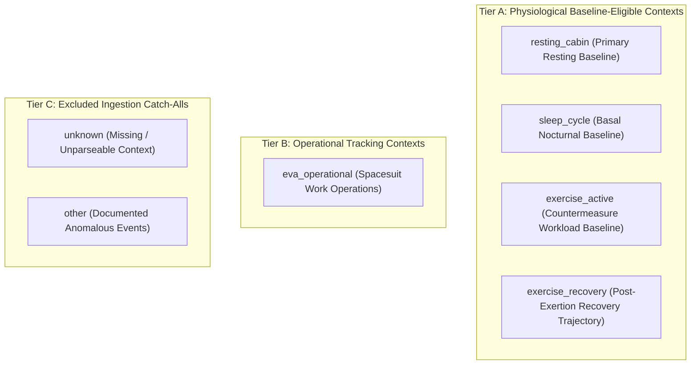

# COSMOLOOKUP — Phase 2A Implementation Report: Measurement Foundation

**Milestone:** Phase 2A — Measurement Catalog, Normalization, Context Metadata, and Validation  
**Date:** 2026-11-14  
**Branch:** `feature/backend-phase-2`  
**Status:** Completed & Validated (44/44 automated tests passing)  
**Author:** Senior Backend Engineer  
**Reference Architecture:** [`docs/architecture/PHASE_2_BASELINE_DESIGN.md`](file:///D:/nasa2026/docs/architecture/PHASE_2_BASELINE_DESIGN.md)

---

## 1. Executive Summary

Phase 2A establishes the scientific measurement foundation, taxonomy, normalization layer, and comparability engine for the **COSMOLOOKUP** astronaut health monitoring platform. This work strictly implements the architectural contracts and scientific alignment directives ratified by Member 3 in [`docs/architecture/PHASE_2_BASELINE_DESIGN.md`](file:///D:/nasa2026/docs/architecture/PHASE_2_BASELINE_DESIGN.md).

Crucially, Phase 2A focuses solely on data hygiene, catalog definitions, and comparability validation. In accordance with architectural boundaries, baseline calculations, maturity grading, trend analysis ($Z_{\text{IQR}}$ scores, Sen's slope), and alert engines are deferred to Phase 2B and beyond.

---

## 2. Measurement Catalog Architecture

The centralized catalog package has been implemented at [`backend/app/catalog/`](file:///D:/nasa2026/backend/app/catalog/) and encapsulates definitions for 9 primary canonical metrics and 1 derived metric.

### 2.1 Canonical Metrics & Sanity Check Ranges

| Canonical Identifier | Display Name | Category | Standard Unit | Wire Aliases | Accepted Units | Valid Physical Range | Hardware Source Examples | Strict Site Matching |
|---|---|---|---|---|---|---|---|---|
| `heart_rate` | Heart Rate | cardiovascular | `bpm` | `hr` | `bpm`, `beats/min` | $30.0 - 220.0$ | BioHarness chest band, 3-lead ECG | No |
| `spo2` | Oxygen Saturation (SpO2) | respiratory | `%` | `blood_oxygen` | `%`, `percent`, `pct` | $70.0 - 100.0$ | Pulse Oximeter Optical Band | No |
| `body_temperature` | Body Temperature | thermal | `celsius` | *(None)* | `celsius`, `fahrenheit`, `degc`, `degf` | $34.0 - 42.0$ | Infrared skin probe, Wearable sensor band | No |
| `core_temperature` | Core Body Temperature | thermal | `celsius` | *(None)* | `celsius`, `fahrenheit`, `degc`, `degf` | $35.0 - 42.0$ | Ingestible telemetric core pill (LSDA) | Yes |
| `blood_pressure_systolic` | Systolic Blood Pressure | cardiovascular | `mmHg` | `bp_systolic` | `mmHg`, `mm_hg` | $70.0 - 220.0$ | Ambulatory arterial cuff | No |
| `blood_pressure_diastolic` | Diastolic Blood Pressure | cardiovascular | `mmHg` | `bp_diastolic` | `mmHg`, `mm_hg` | $40.0 - 130.0$ | Ambulatory arterial cuff | No |
| `respiratory_rate` | Respiratory Rate | respiratory | `breaths/min` | `rr` | `breaths/min`, `rpm`, `brpm` | $4.0 - 45.0$ | Inductive plethysmography band | No |
| `sleep_duration` | Sleep Duration | sleep | `hours` | *(None)* | `hours`, `h`, `hrs` | $0.0 - 16.0$ | Actigraphy sleep-staging monitor | No |
| `radiation_dose` | Radiation Dose | environmental | `mSv` | *(None)* | `mSv`, `msv` | $0.0 - 500.0$ | Crew Active Personal Dosimeter | No |
| `mean_arterial_pressure` | Mean Arterial Pressure (MAP) | cardiovascular | `mmHg` | `map` | `mmHg`, `mm_hg` | $40.0 - 160.0$ | Derived: $\text{DBP} + \frac{1}{3}(\text{SBP} - \text{DBP})$ | No |

### 2.2 Strict Temperature Independence (`body_temperature` vs. `core_temperature`)

In microgravity, spaceflight-associated core hyperthermia typically elevates deep visceral core temperature by $0.5 - 1.0^\circ\text{C}$ due to diminished convective heat loss, whereas surface skin temperature fluctuates dynamically with habitat ventilation, clothing, and localized evaporation. 

To prevent systemic physiological errors:
1. **Zero Cross-Aliasing:** `body_temperature` and `core_temperature` resolve to independent canonical types.
2. **Query Isolation:** Querying `GET /api/v1/astronauts/{id}/measurements?measurement_type=body_temperature` strictly queries only `body_temperature` records and never returns `core_temperature` data, and vice versa.
3. **Comparability Rejection:** The comparability engine returns `are_comparable = False` with reason citing distinct physiological metrics whenever body and core temperature records are evaluated against each other.
4. **Superficial Site Guard:** Ingestion validation strictly rejects attempts to record `core_temperature` using superficial sites (e.g. `skin`, `axilla`, `temporal`, `forehead`).

### 2.3 SpO2 Backward Compatibility

[`docs/api/API_CONTRACT.md`](file:///D:/nasa2026/docs/api/API_CONTRACT.md) documents `blood_oxygen`. The normalization layer resolves `blood_oxygen` to canonical `spo2` while maintaining full backward compatibility:
- Query expansion automatically maps `blood_oxygen` queries to SQL `WHERE measurement_type IN ('blood_oxygen', 'spo2')`.
- Telemetry points recorded as `blood_oxygen` and `spo2` under the same context are validated as comparable.
- Historical stored values in the database are never mutated.

---

## 3. Context Taxonomy & Decoupled Exercise Modalities

### 3.1 Three-Tier Functional Context Taxonomy

Context classification is separated into three functional tiers in [`backend/app/catalog/context.py`](file:///D:/nasa2026/backend/app/catalog/context.py):



- **Baseline Eligibility:** `is_baseline_eligible(context)` evaluates to `True` exclusively for Tier A.
- **EVA Context Nuance:** Extravehicular activity (`eva_operational`) is recognized as an operational work envelope rather than a uniform physiological state. EVA telemetry is monitored in real-time but **strictly excluded from habitat resting or countermeasure baselines**.
- **Catch-Alls:** Unclassified readings (`unknown`, `other`) are ingested for raw telemetry completeness but excluded from all baseline cohorts.

### 3.2 Decoupled Exercise Equipment Modalities

Countermeasure hardware modalities are decoupled from the general operational context:
- Supported modalities: `ared_resistive`, `cevis_aerobic`, `t2_treadmill`, `other`, `unknown`.
- **Equipment Isolation Rule:** Telemetry from anaerobic loading on the Advanced Resistive Exercise Device (`ared_resistive`) is never comparable to aerobic cycling (`cevis_aerobic`) or running (`t2_treadmill`). Comparing disparate exercise modalities returns `are_comparable = False` with `mismatched_dimensions = ["exercise_modality"]`.

---

## 4. Normalization and Comparability Engine

The normalization engine in [`backend/app/catalog/normalizer.py`](file:///D:/nasa2026/backend/app/catalog/normalizer.py) provides two primary functions:

1. **`normalize_and_validate_measurement(...) -> ValidationResult`:**
   - Resolves incoming wire aliases to canonical identifiers.
   - Converts temperature readings in Fahrenheit ($^\circ\text{F}$) to Celsius ($^\circ\text{C}$) via $(\text{val} - 32) \times \frac{5}{9}$.
   - Verifies numerical readings fall within physically plausible biological boundaries.
   - Flags incompatible anatomical sites for deep visceral core telemetry.
2. **`are_measurements_comparable(m1, m2) -> ComparabilityResult`:**
   - Evaluates whether two observations (or an observation and a baseline partition) can be compared.
   - Evaluates canonical metric equivalence, operational context match, equipment modality match, and anatomical site/method compatibility.

---

## 5. Database & API Backward Compatibility

### 5.1 Schema Extensions

Optional, nullable metadata columns were added to `Measurement` in [`backend/app/models/measurement.py`](file:///D:/nasa2026/backend/app/models/measurement.py):
- `exercise_modality: Mapped[Optional[str]] = mapped_column(String(64), nullable=True, default=None)`
- `measurement_site: Mapped[Optional[str]] = mapped_column(String(64), nullable=True, default=None)`
- `measurement_method: Mapped[Optional[str]] = mapped_column(String(64), nullable=True, default=None)`
- `sensor_model: Mapped[Optional[str]] = mapped_column(String(64), nullable=True, default=None)`
- `mission_day: Mapped[Optional[int]] = mapped_column(Integer, nullable=True, default=None)`

### 5.2 Non-Destructive SQLite Startup Migration

An automatic schema upgrade check was integrated into the FastAPI application lifespan in [`backend/app/main.py`](file:///D:/nasa2026/backend/app/main.py). When starting up against an existing SQLite database file, `PRAGMA table_info(measurement)` is inspected. Any missing metadata columns are added via `ALTER TABLE measurement ADD COLUMN ...` statements idempotently without dropping or modifying existing rows.

### 5.3 API Preservation and New Query Filters

1. **Phase 1 Contract Preservation:**
   - `GET /api/v1/astronauts`
   - `GET /api/v1/astronauts/{id}`
   - `GET /api/v1/astronauts/{id}/measurements`
   All Phase 1 payload structures, envelope keys (`astronaut_id`, `data`, `total`, `limit`, `offset`), and data types remain identical.
2. **New Query Parameters:**
   - `?context=`: Filter measurements by context category (e.g. `resting_cabin`, `exercise_active`).
   - `?exercise_modality=`: Filter measurements by equipment modality (e.g. `ared_resistive`).
3. **Dynamic Catalog Discovery Endpoint:**
   - `GET /api/v1/measurements/catalog`: Returns canonical metrics, physical boundaries, functional context tiers, and exercise modalities.

---

## 6. Verification and Test Results

A dedicated automated test suite was implemented in [`backend/tests/test_phase2a_foundation.py`](file:///D:/nasa2026/backend/tests/test_phase2a_foundation.py).

```
============================= test session starts =============================
platform win32 -- Python 3.12.3, pytest-8.4.2, pluggy-1.7.0 -- D:\nasa2026\backend\.venv\Scripts\python.exe
cachedir: .pytest_cache
rootdir: D:\nasa2026
plugins: anyio-4.16.0
collected 44 items

backend/tests/test_astronauts.py::test_list_astronauts_empty PASSED      [  2%]
backend/tests/test_astronauts.py::test_list_astronauts_with_data PASSED  [  4%]
backend/tests/test_astronauts.py::test_list_astronauts_mission_filter PASSED [  6%]
backend/tests/test_astronauts.py::test_list_astronauts_pagination PASSED [  9%]
backend/tests/test_astronauts.py::test_list_astronauts_invalid_limit PASSED [ 11%]
backend/tests/test_astronauts.py::test_get_astronaut_by_id_success PASSED [ 13%]
backend/tests/test_astronauts.py::test_get_astronaut_by_id_not_found PASSED [ 15%]
backend/tests/test_health.py::test_health_check_root PASSED              [ 18%]
backend/tests/test_health.py::test_health_check_v1 PASSED                [ 20%]
backend/tests/test_measurements.py::test_get_measurements_for_astronaut_success PASSED [ 22%]
backend/tests/test_measurements.py::test_get_measurements_empty_results PASSED [ 25%]
backend/tests/test_measurements.py::test_get_measurements_astronaut_not_found PASSED [ 27%]
backend/tests/test_measurements.py::test_get_measurements_filter_type PASSED [ 29%]
backend/tests/test_measurements.py::test_get_measurements_filter_time_range PASSED [ 31%]
backend/tests/test_measurements.py::test_get_measurements_invalid_start_time PASSED [ 34%]
backend/tests/test_measurements.py::test_get_measurements_pagination PASSED [ 36%]
backend/tests/test_measurements.py::test_measurement_association_isolation PASSED [ 38%]
backend/tests/test_phase2a_foundation.py::test_catalog_contains_all_canonical_metrics PASSED [ 40%]
backend/tests/test_phase2a_foundation.py::test_alias_resolution PASSED   [ 43%]
backend/tests/test_phase2a_foundation.py::test_temperature_strict_independence PASSED [ 45%]
backend/tests/test_phase2a_foundation.py::test_spo2_compatible_aliasing PASSED [ 47%]
backend/tests/test_phase2a_foundation.py::test_unit_normalization_and_temperature_conversion PASSED [ 50%]
backend/tests/test_phase2a_foundation.py::test_unit_normalization_other_metrics PASSED [ 52%]
backend/tests/test_phase2a_foundation.py::test_physical_range_boundaries[heart_rate-75.0-25.0-230.0-bpm] PASSED [ 54%]
backend/tests/test_phase2a_foundation.py::test_physical_range_boundaries[spo2-98.0-65.0-105.0-%] PASSED [ 56%]
backend/tests/test_phase2a_foundation.py::test_physical_range_boundaries[body_temperature-36.8-33.0-43.0-celsius] PASSED [ 59%]
backend/tests/test_phase2a_foundation.py::test_physical_range_boundaries[core_temperature-37.2-34.0-43.0-celsius] PASSED [ 61%]
backend/tests/test_phase2a_foundation.py::test_physical_range_boundaries[blood_pressure_systolic-120.0-50.0-240.0-mmHg] PASSED [ 63%]
backend/tests/test_phase2a_foundation.py::test_physical_range_boundaries[blood_pressure_diastolic-80.0-30.0-140.0-mmHg] PASSED [ 65%]
backend/tests/test_phase2a_foundation.py::test_physical_range_boundaries[respiratory_rate-14.0-2.0-50.0-breaths/min] PASSED [ 68%]
backend/tests/test_phase2a_foundation.py::test_physical_range_boundaries[sleep_duration-8.0--1.0-20.0-hours] PASSED [ 70%]
backend/tests/test_phase2a_foundation.py::test_physical_range_boundaries[radiation_dose-1.5--0.5-600.0-mSv] PASSED [ 72%]
backend/tests/test_phase2a_foundation.py::test_core_temperature_superficial_site_rejection PASSED [ 75%]
backend/tests/test_phase2a_foundation.py::test_context_taxonomy_tiers PASSED [ 77%]
backend/tests/test_phase2a_foundation.py::test_context_normalization PASSED [ 79%]
backend/tests/test_phase2a_foundation.py::test_exercise_modality_taxonomy PASSED [ 81%]
backend/tests/test_phase2a_foundation.py::test_exercise_modality_isolation_rule PASSED [ 84%]
backend/tests/test_phase2a_foundation.py::test_comparability_context_isolation PASSED [ 86%]
backend/tests/test_phase2a_foundation.py::test_core_temperature_site_comparability PASSED [ 88%]
backend/tests/test_phase2a_foundation.py::test_api_catalog_discovery_endpoint PASSED [ 90%]
backend/tests/test_phase2a_foundation.py::test_api_spo2_alias_expansion PASSED [ 93%]
backend/tests/test_phase2a_foundation.py::test_api_temperature_strict_filtering PASSED [ 95%]
backend/tests/test_phase2a_foundation.py::test_api_context_and_modality_filters PASSED [ 97%]
backend/tests/test_phase2a_foundation.py::test_phase2a_metadata_persistence_and_serialization PASSED [100%]

======================== 44 passed, 1 warning in 0.56s ========================
```

---

## 7. Scope Boundaries & Next Phase Readiness

The following items are intentionally excluded from Phase 2A and reserved for Phase 2B:
- **Phase 2B:** Statistical baseline calculation engine (Median, IQR, Mean, Standard Deviation), Dual Baseline framework (`preflight` vs. `inflight`), baseline maturity progression (`insufficient` $\to$ `provisional` $\to$ `established`), and versioned storage in `astronaut_baseline`.
- **Phase 2C:** Trend analysis engine ($Z_{\text{IQR}}$ scores, Sen's slope non-parametric drift estimator, consecutive-run rules, multi-tier decision-support classifications).
