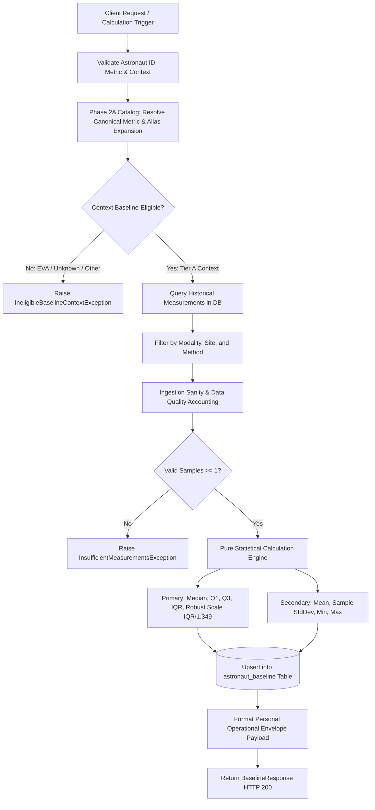

# COSMOLOOKUP — Phase 2B Implementation Report: Baseline Calculation Engine

**Milestone:** Phase 2B — Personal Baseline Calculation Engine & Operational Envelopes  
**Date:** 2026-11-14  
**Branch:** `feature/backend-phase-2b`  
**Status:** Completed & Validated (63/63 automated tests passing)  
**Author:** Senior Backend Engineer  
**Reference Architecture:** [`docs/architecture/PHASE_2_BASELINE_DESIGN.md`](file:///D:/nasa2026/docs/architecture/PHASE_2_BASELINE_DESIGN.md)  
**Catalog & Taxonomy Foundation:** [`docs/development/PHASE_2A_IMPLEMENTATION.md`](file:///D:/nasa2026/docs/development/PHASE_2A_IMPLEMENTATION.md)

---

## 1. Executive Summary

Phase 2B implements the core personal baseline calculation engine and Personal Operational Envelopes for the **COSMOLOOKUP** astronaut health monitoring platform. 

The engine quantifies an individual astronaut's intra-individual physiological norms using historical observations partitioned under strictly comparable conditions. By deriving non-parametric order statistics (median, interquartile range) and secondary parametric metrics (mean, standard deviation), the platform provides flight surgeons and crew medical officers with robust, objective operational reference boundaries without asserting medical diagnostic thresholds.

---

## 2. Implemented Architecture

The baseline engine is structured as a dedicated domain service integrated within the FastAPI backend architecture:



### Key Service Components
- **`backend/app/models/baseline.py`:** `AstronautBaseline` SQLAlchemy 2.0 ORM model with composite lookup indices and relational link to `Astronaut`.
- **`backend/app/schemas/baseline.py`:** Pydantic v2 schemas defining `PersonalOperationalEnvelope`, `BaselineQualitySummary`, `BaselineResponse`, and `BaselineCalculationRequest`.
- **`backend/app/services/baseline_service.py`:** Reusable domain engine providing `calculate_baseline_statistics()`, `calculate_and_persist_baseline()`, `get_baseline_for_astronaut()`, and `list_baselines_for_astronaut()`.
- **`backend/app/api/v1/endpoints/baselines.py`:** API endpoints for baseline calculation, listing, and single-metric retrieval.

---

## 3. Database Changes: `AstronautBaseline`

A dedicated entity `AstronautBaseline` has been added to [`backend/app/models/baseline.py`](file:///D:/nasa2026/backend/app/models/baseline.py) and registered in [`backend/app/models/__init__.py`](file:///D:/nasa2026/backend/app/models/__init__.py):

| Column | Data Type | Nullable | Constraints & Description |
|---|---|---|---|
| `id` | `VARCHAR(64)` | No | **Primary Key**. Unique baseline record identifier. |
| `astronaut_id` | `VARCHAR(64)` | No | **Foreign Key** referencing `astronaut(id)` with `ON DELETE CASCADE`. |
| `measurement_type` | `VARCHAR(64)` | No | Canonical metric identifier (e.g. `heart_rate`, `spo2`, `body_temperature`). |
| `context` | `VARCHAR(64)` | No | Physiological context partition (`CHECK (context IN ('resting_cabin', 'sleep_cycle', 'exercise_active', 'exercise_recovery'))`). |
| `exercise_modality` | `VARCHAR(64)` | Yes | Countermeasure hardware modality (`ared_resistive`, `cevis_aerobic`, `t2_treadmill`). |
| `measurement_site` | `VARCHAR(64)` | Yes | Anatomical observation site. |
| `measurement_method` | `VARCHAR(64)` | Yes | Protocol or technique descriptor. |
| `sensor_model` | `VARCHAR(64)` | Yes | Sensor model designation. |
| `unit` | `VARCHAR(32)` | No | Standard canonical unit. |
| `median` | `REAL` | No | Personal median (primary location reference). |
| `q25` | `REAL` | No | First quartile / 25th percentile. |
| `q75` | `REAL` | No | Third quartile / 75th percentile. |
| `iqr` | `REAL` | No | Interquartile range ($Q_3 - Q_1$, primary scale reference). |
| `mean` | `REAL` | No | Sample arithmetic mean (secondary descriptive metric). |
| `std_dev` | `REAL` | No | Sample standard deviation (secondary descriptive metric). |
| `robust_scale_iqr` | `REAL` | No | Gaussian-equivalent robust scale estimate ($\text{IQR} / 1.349$). |
| `min_value` | `REAL` | No | Lowest observed value in cohort. |
| `max_value` | `REAL` | No | Highest observed value in cohort. |
| `sample_count` | `INTEGER` | No | Count of valid contributing telemetry measurements (`CHECK (sample_count >= 0)`). |
| `nominal_count` | `INTEGER` | No | Count of nominal telemetry points evaluated. |
| `degraded_count` | `INTEGER` | No | Count of degraded/noisy telemetry points evaluated. |
| `window_start` | `TIMESTAMP WITH TIME ZONE` | Yes | Timestamp of earliest contributing observation in cohort. |
| `window_end` | `TIMESTAMP WITH TIME ZONE` | Yes | Timestamp of latest contributing observation in cohort. |
| `algorithm_version` | `VARCHAR(32)` | No | Algorithm version string (`v2b-iqr`). |
| `is_synthetic` | `BOOLEAN` | No | Synthetic provenance indicator. |
| `calculated_at` | `TIMESTAMP WITH TIME ZONE` | No | UTC timestamp of baseline generation. |

#### Indices & Relationships
- `idx_baseline_lookup`: Composite index on `(astronaut_id, measurement_type, context)`.
- `idx_baseline_astronaut`: Foreign key index on `astronaut_id`.
- `Astronaut.baselines`: Cascading 1:N relationship ensuring clean lifecycle management.

---

## 4. Statistical Methodology

### 4.1 Primary Non-Parametric Statistics
Because physiological telemetry in microgravity is vulnerable to motion artifacts, sensor displacement, and non-Gaussian skewness, non-parametric order statistics serve as the primary baseline foundation:
- **Median ($\tilde{x}$):** The central value (50th percentile), offering a 50% breakdown point resistant to extreme sensor spikes.
- **Quartiles ($Q_1, Q_3$):** 25th and 75th percentiles calculated via the inclusive linear interpolation method (`statistics.quantiles(..., method='inclusive')`), consistent with standard scientific percentile conventions.
- **Interquartile Range ($\text{IQR} = Q_3 - Q_1$):** Measures the spread of the middle 50% of the astronaut's readings.
- **Personal Operational Envelope:** Defined by $[Q_1, Q_3]$, representing the astronaut's typical operational homeostatic envelope for that contextual state.

### 4.2 Robust Scale Estimator ($\sigma_{\text{IQR}}$)
Under an ideal standard Gaussian distribution $\mathcal{N}(\mu, \sigma^2)$, the theoretical interquartile range is:
$$\text{IQR} = Q_3 - Q_1 = 2 \times 0.67449\sigma \approx 1.34898\sigma$$

The engine derives:
$$\sigma_{\text{IQR}} = \frac{\text{IQR}}{1.34898} \approx \frac{\text{IQR}}{1.349}$$

- **Gaussian Consistency:** $\sigma_{\text{IQR}}$ serves as a consistent scale estimator for standard deviation under the assumption of normal underlying variation.
- **Zero-IQR Safety:** If an astronaut exhibits identical telemetry readings across all observations ($\text{IQR} = 0.0$), $\sigma_{\text{IQR}}$ safely defaults to `0.0` without division by zero errors.

### 4.3 Secondary Descriptive Statistics
- **Sample Mean ($\bar{x}$):** Arithmetic average.
- **Sample Standard Deviation ($s$):** Evaluated with Bessel's correction ($N - 1$ degrees of freedom) for $N \ge 2$; defaults to `0.0` for single-sample cohorts ($N = 1$).
- **Observed Range:** $[x_{\min}, x_{\max}]$.

---

## 5. Comparability Rules & Data Quality Handling

The engine strictly enforces the comparability framework established in Phase 2A:

1. **Context Isolation:**
   - Baselines can only be formed from Tier A Physiological Baseline-Eligible contexts (`resting_cabin`, `sleep_cycle`, `exercise_active`, `exercise_recovery`).
   - Extravehicular Activity (`eva_operational`) is recognized as an operational work envelope and is **strictly prohibited from habitat baseline pooling**. Attempting to calculate an EVA baseline raises `IneligibleBaselineContextException` with an explicit scientific rationale.
   - Ingestion catch-alls (`unknown`, `other`) are rejected from baseline calculations.
2. **Exercise Modality Decoupling:**
   - Countermeasure equipment is strictly isolated. High anaerobic loading on the Advanced Resistive Exercise Device (`ared_resistive`) is never pooled with aerobic cycling (`cevis_aerobic`) or treadmill running (`t2_treadmill`).
3. **Strict Temperature Independence:**
   - `body_temperature` (wearable skin sensor) and `core_temperature` (ingestible core pill) have zero cross-aliasing and formulate strictly separate baselines.
4. **Wire Alias Resolution:**
   - Telemetry stored as `blood_oxygen` is resolved into canonical `spo2` baseline cohorts via SQL query expansion without modifying historical database records.
5. **Data Quality Transparency:**
   - Rather than silently accepting noisy data or dropping quality markers, the engine segregates records by `data_quality`.
   - By default (`include_degraded = False`), only `nominal` readings contribute to baseline statistics.
   - The response includes `quality_summary` (`nominal`, `degraded`, `total_evaluated`) so operators transparently understand telemetry fidelity across the evaluation window.

---

## 6. API Endpoints

The baseline endpoints are documented in [`docs/api/API_CONTRACT.md`](file:///D:/nasa2026/docs/api/API_CONTRACT.md) and exposed under `/api/v1`:

### 6.1 `POST /api/v1/astronauts/{astronaut_id}/baselines/calculate`
Calculates, persists, and returns the baseline envelope.
- **Request Body:**
  ```json
  {
    "measurement_type": "heart_rate",
    "context": "resting_cabin",
    "exercise_modality": null,
    "measurement_site": null,
    "measurement_method": null,
    "include_degraded": false,
    "start_time": null,
    "end_time": null
  }
  ```
- **Response:** HTTP `200 OK` with `BaselineResponse` envelope.
- **Idempotency:** Subsequent calculation calls for the same astronaut, metric, and context update the existing baseline record in-place rather than creating duplicate rows.

### 6.2 `GET /api/v1/astronauts/{astronaut_id}/baselines`
Retrieves all calculated baselines for the astronaut.
- **Query Parameter:** `context` (optional filter).
- **Response:** HTTP `200 OK` with `BaselineListResponse`.

### 6.3 `GET /api/v1/astronauts/{astronaut_id}/baselines/{measurement_type}`
Retrieves a specific baseline by metric identifier (accepts aliases such as `blood_oxygen` $\to$ `spo2`).
- **Query Parameters:** `context` (optional, default `resting_cabin`), `exercise_modality` (optional).
- **Response:** HTTP `200 OK` with `BaselineResponse` or HTTP `404 Not Found` (`BASELINE_NOT_FOUND`).

---

## 7. Verification & Automated Test Results

A comprehensive test suite containing 19 dedicated integration tests was created in [`backend/tests/test_phase2b_baseline_engine.py`](file:///D:/nasa2026/backend/tests/test_phase2b_baseline_engine.py).

```
============================= test session starts =============================
platform win32 -- Python 3.12.3, pytest-8.4.2, pluggy-1.7.0 -- D:\nasa2026\backend\.venv\Scripts\python.exe
cachedir: .pytest_cache
rootdir: D:\nasa2026
plugins: anyio-4.16.0
collected 63 items

backend/tests/test_astronauts.py .................................. [  7 passed ]
backend/tests/test_health.py ...................................... [  2 passed ]
backend/tests/test_measurements.py ................................ [  8 passed ]
backend/tests/test_phase2a_foundation.py .......................... [ 27 passed ]
backend/tests/test_phase2b_baseline_engine.py ..................... [ 19 passed ]

======================== 63 passed, 1 warning in 0.76s ========================
```

### Coverage Highlights:
- **Statistical Accuracy:** Verified median, quartiles, IQR, robust scale estimate ($\text{IQR} / 1.349$), sample mean, and standard deviation against exact mathematical benchmarks.
- **Zero-IQR & Single-Sample Safety:** Verified zero-division safety on constant datasets and single-measurement cohorts.
- **Data Quality Accounting:** Confirmed degraded telemetry segregation and transparent provenance reporting.
- **Boundary Validation:** Verified out-of-range sensor readings are excluded from baselines.
- **Alias & Temperature Independence:** Confirmed `blood_oxygen` queries calculate canonical `spo2` baselines, and `body_temperature` baselines remain 100% isolated from `core_temperature`.
- **Modality & Context Isolation:** Verified ARED resistive vs. CEVIS aerobic equipment isolation, EVA operational context rejection, and unclassified context exclusion.
- **Multi-Astronaut Segregation:** Verified zero data leakage between distinct astronaut baseline records.
- **Idempotent Refresh:** Verified subsequent calculations refresh existing baseline records without duplicate rows.
- **API Error Handling:** Verified standard error envelopes for `ASTRONAUT_NOT_FOUND` (404), `BASELINE_NOT_FOUND` (404), `INELIGIBLE_BASELINE_CONTEXT` (400), `INSUFFICIENT_MEASUREMENTS` (422), and `INVALID_QUERY_PARAMETER` (400).

---

## 8. Scientific Limitations & Boundaries

1. **Non-Diagnostic Reference:** Baselines represent statistical intra-individual reference ranges. They **must not** be interpreted as aeromedical certification limits, flight rule thresholds, or clinical diagnoses.
2. **Scale Estimation Assumption:** The robust scale estimate $\sigma_{\text{IQR}} = \text{IQR} / 1.349$ is a Gaussian-equivalent scale estimator. When physiological telemetry exhibits heavy skewness (e.g. countermeasure recovery tails), $\sigma_{\text{IQR}}$ serves as a robust dispersion proxy rather than an exact standard deviation.
3. **No Unjustified Outlier Deletion:** The engine does not automatically discard unusual measurements simply because they sit outside $[Q_1 - 1.5 \times \text{IQR}, Q_3 + 1.5 \times \text{IQR}]$. Outliers are retained in the database; only physically impossible or sensor-incompatible readings are filtered during baseline formulation.

---

## 9. Deferred Scope (Phase 2C & Phase 3)

In accordance with project scope boundaries, the following capabilities are deferred:
- **Phase 2C:** Preflight vs. In-flight dual baseline framework (`baseline_type = 'preflight' | 'inflight'`), baseline versioning (`version = 1, 2, ...`), and maturity progression (`insufficient` $\to$ `provisional` $\to$ `established`).
- **Phase 3:** Real-time trend evaluation, robust Z-scores ($Z_{\text{IQR}}$), Sen's slope non-parametric trajectory estimation, consecutive-run rules, and multi-tier decision-support alerts.
